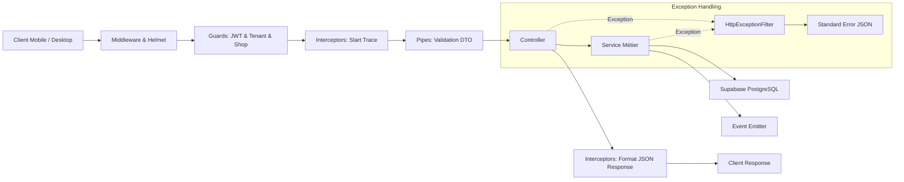

# 01 — Architecture Globale & Standards Techniques du Backend

Ce document détaille l'organisation structurelle, les choix architecturaux et les standards de code appliqués au backend de **ARIKE (VenteApp)**.

---

## 1. Philosophie Architecturale : Monolithe Modulaire

Le backend d'ARIKE est conçu selon le paradigme du **Monolithe Modulaire** (Modular Monolith) avec des frontières de domaines strictes (Domain-Driven Design).

### Pourquoi ce choix ?
1. **Vélocité & Simplicité d'Exploitation** : Une seule unité de déploiement (un container ou un process Node.js), évitant la complexité réseau, les latences inter-services et la coordination distribuée des microservices.
2. **Isolation par Domaine Métier** : Chaque sous-système (Ventes, Stocks, Caisses, Dettes, Abonnements) est encapsulé dans son propre module NestJS avec son Controller, son Service, ses DTOs et ses interfaces.
3. **Évolution Future Garantie** : Les modules communiquent via des interfaces explicites et l'Event Bus NestJS (`@nestjs/event-emitter`). Si un module nécessite plus tard un scaling indépendant, il peut être extrait en microservice sans réécrire la logique métier.

---

## 2. Arborescence du Code Source (`backend/src`)

```text
backend/src/
├── core/                       # Fondations transversales et abstractions
│   ├── config/                 # Gestion de la configuration (ConfigService, env)
│   ├── decorators/             # Décorateurs personnalisés (@CurrentUser, @Roles, etc.)
│   ├── filters/                # Filtres d'exceptions globaux (HttpExceptionFilter)
│   ├── guards/                 # Gardes de sécurité (JwtAuthGuard, RolesGuard, ShopGuard)
│   ├── interceptors/           # Transformateurs de réponse, logging, timing
│   └── pipes/                  # Pipes de validation et de transformation (ValidationPipe)
│
├── infrastructure/             # Connecteurs et clients externes
│   ├── supabase/               # Client Supabase PostgreSQL managé
│   └── infrastructure.module.ts
│
├── modules/                    # Modules Métier (28 domaines applicatifs)
│   ├── auth/                   # Connexion, rafraîchissement, OTP WhatsApp
│   ├── rbac/                   # Rôles, permissions, affectations
│   ├── tenants/                # Gestion des organisations clientes
│   ├── shops/                  # Gestion multi-boutiques et hiérarchie
│   ├── users/                  # Profils utilisateurs et caissiers
│   ├── inventory/              # Produits, catégories, lots, mouvements de stock
│   ├── sales/                  # Caisse enregistreuse, tickets, encaissements
│   ├── sales-orders/           # Commandes clients, livraisons, avoirs
│   ├── cash-sessions/          # Sessions de caisse, ouvertures, clôtures, écarts
│   ├── debts/                  # Dettes clients, échéanciers, remboursements
│   ├── customers/              # Répertoire client, soldes, plafonds de crédit
│   ├── purchases/              # Approvisionnements et commandes fournisseurs
│   ├── stock-transfers/        # Transferts de marchandises inter-boutiques
│   ├── expenses/               # Dépenses d'exploitation et charges fixes
│   ├── calculators/            # Outils de marge, TVA, rentabilité
│   ├── fx-exchange/            # Change de devises (FCFA / Euro / Dollar / Naira)
│   ├── notifications/          # Centre de notifications in-app et alertes
│   ├── audit/                  # Traçabilité inaltérable des actions sensibles
│   ├── subscription/           # Plans tarifaires, quotas, gestion Stripe/MoMo
│   ├── licensing/              # Génération et validation de licences hors-ligne
│   ├── app-updates/            # Serveur de distribution des mises à jour APK/EXE
│   └── admin/                  # Console d'administration centrale (SuperAdmin)
│
├── shared/                     # Utilitaires, constantes, enums et types partagés
│   ├── constants/
│   ├── enums/
│   └── utils/
│
├── app.module.ts               # Module racine orchestrant l'ensemble de l'application
└── main.ts                     # Point d'entrée de l'application (bootstrap)
```

---

## 3. Cycle de Vie d'une Requête HTTP (Request Pipeline)

Chaque requête entrante traverse une série de couches standardisées garantissant sécurité, isolation et validation des données :



### 3.1 Les Gardes (`Guards`)
- **`JwtAuthGuard`** : Vérifie l'en-tête `Authorization: Bearer <token>`, décode le token JWT et injecte les informations du compte dans `request.user`.
- **`TenantGuard`** : Extrait l'en-tête `X-Tenant-ID` et vérifie que l'utilisateur connecté appartient bien à ce tenant.
- **`ShopGuard`** : Vérifie que le `X-Shop-ID` fourni correspond à une boutique active autorisée pour l'utilisateur.
- **`PermissionsGuard` / `RolesGuard`** : Compare les permissions requises annotées avec `@RequirePermissions(Permission.xxx)` aux permissions réelles de l'utilisateur.

### 3.2 Les Pipes de Validation (`Pipes`)
Le `ValidationPipe` global configuré dans `main.ts` applique les règles suivantes :
- `whitelist: true` : Supprime automatiquement toute propriété non déclarée dans le DTO.
- `forbidNonWhitelisted: true` : Rejette avec HTTP 400 toute requête contenant des champs inconnus (anti-injection).
- `transform: true` : Convertit automatiquement les chaînes numériques ou booléennes vers leurs types primitifs TypeScript.

### 3.3 Format Standardisé des Réponses JSON
Toutes les réponses de l'API sont normalisées par un `TransformInterceptor` global :

#### Succès (HTTP 200, 201)
```json
{
  "success": true,
  "data": { ... },
  "meta": {
    "timestamp": "2026-11-17T15:30:00.000Z",
    "page": 1,
    "limit": 20,
    "total": 145
  }
}
```

#### Erreur (HTTP 400, 401, 403, 404, 500)
Capturée par `HttpExceptionFilter` :
```json
{
  "success": false,
  "error": {
    "code": "CASH_SESSION_CLOSED",
    "message": "La session de caisse est déjà clôturée.",
    "details": null,
    "timestamp": "2026-11-17T15:30:00.000Z",
    "path": "/api/v1/cash-sessions/close"
  }
}
```

---

## 4. Architecture Événementielle (Event-Driven)

Les modules utilisent `@nestjs/event-emitter` pour découpler les opérations annexes du flux critique de la requête :

- **Exemple 1 : Vente enregistrée (`sale.completed`)** :
  1. Le service `SalesService` valide la vente et décrémente le stock en base.
  2. Il émet l'événement `sale.completed` avec les détails de la vente.
  3. L'écouteur `AuditListener` enregistre l'événement d'audit.
  4. L'écouteur `DebtListener` met à jour le compte client si la vente comporte un reliquat à crédit.
  5. L'écouteur `CashSessionListener` incrémente le total encaissé de la caisse ouverte.
  6. L'écouteur `NotificationListener` vérifie si des seuils d'alerte stock critique sont franchis.

Ce découplage garantit que si l'envoi d'une notification échoue, la vente elle-même reste validée avec succès.

