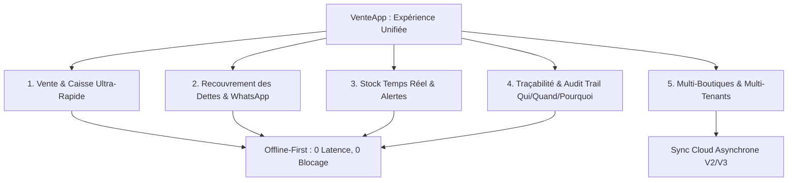

# Document de Cadrage Stratégique & Projet — VenteApp (ARIKE)

---

## 1. Informations Générales & Métadonnées

| Attribut | Valeur |
| :--- | :--- |
| **Nom du Projet** | **VenteApp (Nom Commercial : ARIKE)** |
| **Sous-titre** | Solution de Gestion Commerciale, de Caisse & de Recouvrement Offline-First |
| **Version du Document** | **3.0.0 — Étude Complète & Architecture Unifiée** |
| **Date d'Émission** | Juin 2025 (Mise à jour Février 2026) |
| **Statut** | Document de Référence Stratégique & Validé |
| **Zone Géographique Cible** | Bénin (Cotonou, Porto-Novo, Parakou, Abomey-Calavi) & Sous-région UEMOA |
| **Écosystème Technique** | Mobile Flutter (Android/iOS) + Backend NestJS (Multi-Tenant) + Web Back-Office Next.js |

---

## 2. Contexte Économique, Culturel & Problématique

### 2.1 Le Paysage Commercial au Bénin et en Afrique de l'Ouest
Le commerce de détail et de demi-gros constitue l'épine dorsale de l'économie informelle et semi-formelle au Bénin. Des grands marchés emblématiques comme **Dantokpa** (plus grand marché à ciel ouvert d'Afrique de l'Ouest), **Ganhi**, **Ouando** ou **Missèbo**, jusqu'aux boutiques de quartier, supérettes, quincailleries, pharmacies et grossistes d'Abomey-Calavi et de Parakou, les commerçants gèrent quotidiennement des flux intenses de marchandises et de liquidités.

Cependant, ce secteur repose encore massivement sur des méthodes traditionnelles :
- **Registres papier et cahiers de crédit ("cahiers d'ardoise")** : sujets aux pertes, aux dégradations physiques, aux erreurs de calcul et aux falsifications.
- **Opérations financières non formalisées** : difficultés à mesurer précisément le bénéfice net quotidien, la valeur exacte du stock en temps réel et les marges par catégorie.
- **Gestion des créances hautement sensible** : au Bénin, la vente à crédit (*"Prends, tu vas payer après"*) est un vecteur fondamental de fidélisation commerciale fondé sur la confiance interpersonnelle. Mal gérée, elle provoque des impayés massifs, assèche la trésorerie et détruit la rentabilité des commerces.

```
┌────────────────────────────────────────────────────────────────────────┐
│               RÉALITÉS DU TERRAIN COMMERCIAL BÉNINOIS                  │
├────────────────────────────────┬───────────────────────────────────────┤
│ 🔌 Connectivité Instable       │ Coupures fréquentes d'Internet 3G/4G   │
│ ⚡ Alimentation Électrique     │ Dépistage et délestages fréquents     │
│ 📱 Parc Matériel Low-Cost      │ Smartphones Android 2 à 3 GB de RAM   │
│ 💵 Modes de Paiement Mixtes    │ Cash prédominant + Mobile Money (MoMo) │
│ 🤝 Vente à Crédit Culturelle   │ Créances régulières à tracer sans litige│
│ 👥 Risque de Coulage / Fraude  │ Nécessité d'un audit trail inviolable  │
└────────────────────────────────┴───────────────────────────────────────┘
```

### 2.2 Les Faiblesses des Solutions Logicielles Existantes
Les logiciels ERP ou applications de point de vente (POS) occidentaux traditionnels ou développés pour des pays industrialisés échouent systématiquement sur ce terrain pour plusieurs raisons structurelles :
1. **Dépendance totale au Cloud** : Une application bloquée dès que la connexion 4G faiblit ou que le forfait data est épuisé est immédiatement abandonnée par le commerçant.
2. **Complexité ergonomique excessive** : Menus surchargés, terminologie inadaptée, absence de support des flux de Mobile Money locaux (MTN MoMo, Moov Money) et des pratiques de change (Franc CFA / Naira / Euro).
3. **Absence de résilience financière** : Aucune gestion native des acomptes progressifs, du pardon de dette commercial avec motif, ou de l'envoi direct de reçus via WhatsApp (outil de communication universel).

---

## 3. Vision Produit & Proposition de Valeur

### 3.1 La Vision : L'ERP de Poche Populaire & Infaillible
**VenteApp (ARIKE)** est conçue comme l'outil d'autonomie et de prospérité commerciale du commerçant africain. Elle transforme le smartphone ou la tablette du commerçant en un terminal de gestion complet, rapide, sécurisé, et opérationnel **100% hors-ligne**.

> **Notre Promesse Fondamentale :**
> *"Vendez en 3 secondes, suivez chaque franc, recouvrez vos crédits sans dispute, même au fin fond du marché sans le moindre réseau Internet."*



### 3.2 Piliers Fondamentaux de la Solution

1. **Architecture Offline-First Absolue** :
   - Toutes les lectures et écritures métier s'exécutent en millisecondes sur la base de données locale embarquée (SQLite via Drift).
   - L'interface utilisateur ne présente aucun blocage réseau ni indicateur de chargement pour les opérations quotidiennes de vente, de stock, d'encaissement ou de consultation.
2. **Traçabilité Inviolable (Audit Trail & Anti-Fraude)** :
   - Chaque geste commercial sensible (ajustement de stock, annulation de vente dans les 24h, pardon de dette, modification de prix) enregistre automatiquement un instantané immuable : **Qui ? Quand ? Quoi ? Pourquoi ?**
3. **Ancrage Culturel & Pratiques Locales** :
   - Prise en charge native du Franc CFA (montants entiers sans centimes inutiles).
   - Paiements par MTN Mobile Money, Moov Money, Espèces et Crédit.
   - Partage instantané de reçus formatés via **WhatsApp** et impression thermique Bluetooth 58mm/80mm ESC/POS.
   - Module de gestion des sessions de caisse (ouvertures/clôtures avec contrôle des écarts physiques/théoriques).
   - Module de change de devises (XOF, NGN, EUR, USD) pour les zones frontalières et grands marchés.
4. **Évolutivité Structurée (Multi-Boutiques & Multi-Plateformes)** :
   - Préparation dès la conception locale (V1) au passage transparent au multi-utilisateurs (V2), au multi-boutiques et au pilotage distant sur portail Web Back-Office (V3).

---

## 4. Objectifs Stratégiques & Indicateurs Clés de Performance (KPIs)

### 4.1 Objectifs Métier & Commerciaux

| Objectif Stratégique | Métrique / KPI Cible | Impact Attendu |
| :--- | :--- | :--- |
| **Vitesse d'encaissement** | Temps d'enregistrement d'une vente < **5 secondes** | Fluidification des files d'attente aux heures de pointe |
| **Réduction des impayés** | Hausse du taux de recouvrement de **+35% à +50%** | Diminution des pertes sur créances via rappels WhatsApp |
| **Exactitude des stocks** | Écart inventaire physique / stock théorique < **1%** | Élimination des coulages et vols internes |
| **Autonomie Réseau** | Disponibilité locale de **100%** sans coupure | Zéro interruption de vente liée à la panne réseau |
| **Adoption Utilisateur** | Prise en main complète par un vendeur en < **15 minutes** | Zéro friction d'apprentissage, interface très visuelle |

### 4.2 Objectifs Techniques & Qualité Logicielle

| Objectif Technique | Métrique Cible |
| :--- | :--- |
| **Temps de réponse de l'UI** | `< 300 ms` sur appareil d'entrée de gamme (2 GB RAM) |
| **Temps de démarrage à froid (Cold Start)** | `< 1.5 seconde` |
| **Taille de l'application (APK)** | `< 25 Mo` pour téléchargement économique en data |
| **Taux de crash (Crash-free users)** | `> 99.8%` |
| **Conflits de synchronisation de dettes** | **0% de perte financière** (Résolution additive automatique) |

---

## 5. Périmètre du Projet & Trajectoire par Versions (Scoping V1 / V2 / V3)

Le déploiement de VenteApp est structuré en trois grandes phases incrémentales :

```
┌──────────────────────────────────────────────────────────────────────────┐
│                      TRAJECTOIRE PRODUIT VENTEAPP                        │
├─────────────────────────┬─────────────────────────┬──────────────────────┤
│      VERSION 1.0        │       VERSION 2.0       │     VERSION 3.0      │
│   "L'Artisan Autonome"  │   "L'Équipe Connectée"  │  "Le Réseau Leader"  │
├─────────────────────────┼─────────────────────────┼──────────────────────┤
│ • 100% Offline Local    │ • Synchronisation Cloud │ • Multi-boutiques    │
│ • Mono-boutique         │ • Multi-utilisateurs    │ • Back-Office Web    │
│ • Rôle Patron (Owner)   │   (Patron + Vendeurs)   │ • Approvisionnements │
│ • Ventes Standard/Flash │ • Sauvegarde Cloud Auto │ • Transferts inter-  │
│ • Inventaire & Alertes  │ • Résolution Conflits   │   boutiques          │
│ • Dettes & Recouvrement │ • Rôles RBAC avancés    │ • Change FX Devises  │
│ • Reçus WhatsApp / PDF  │ • Sessions de Caisse    │ • Commandes & Livr.  │
│ • Journal Audit Local   │ • Dépenses de Caisse    │ • SaaS Subscriptions │
└─────────────────────────┴─────────────────────────┴──────────────────────┘
```

### 5.1 Version 1.0 — Le Socle Offline-First Robuste (Actif & Validé)
- **Offre Inclus à l'Installation** : Forfait **GRATUIT (Starter)** à **0 FCFA à vie** activé automatiquement dès le premier lancement (1 Boutique, 1 Utilisateur, 100% Offline Local).
- **Architecture** : Application mobile Flutter avec base locale SQLite chiffrée (Drift).
- **Gestion des Ventes** : Mode panier standard avec scan code-barres et mode vente rapide (montant libre).
- **Catalogue & Stocks** : Catégories visuelles (couleurs, icônes), fiches produits, alertes de stock faible, historique des mouvements.
- **Gestion des Dettes** : Création automatique lors d'une vente à crédit, suivi des soldes, acomptes partiels, pardon de dette tracé, relance pré-remplie WhatsApp.
- **Notifications Sonores Hors-Application** : Alertes locales programmées avec sonnerie et vibrations audibles, se déclenchant même si l'application est totalement fermée.
- **Sécurité** : Authentification par code PIN (hachage bcrypt) et biométrie (empreinte digitale), verrouillage automatique.
- **Traçabilité** : Table `audit_logs` locale enregistrant les modifications sensibles.
- **Sauvegardes** : Export chiffré `.venteapp` et sauvegarde locale sécurisée.

### 5.2 Version 2.0 — Collaboration, Sessions de Caisse & Synchronisation Cloud
- **Multi-Utilisateurs & RBAC** : Rôles Patron (`OWNER`), Vendeur (`SELLER`), Caissier (`CASHIER`), Lecteur (`VIEWER`).
- **Sessions de Caisse (Cash Management)** : Ouverture de caisse avec fond initial, enregistrement des entrées/sorties d'espèces, clôture avec comptage physique et calcul d'écart.
- **Gestion des Dépenses (Expenses)** : Enregistrement des frais d'exploitation courants (loyer, électricité, transport, rations) avec affectation aux sessions de caisse.
- **Synchronisation Cloud Asynchrone (Supabase / NestJS)** : File d'attente `sync_queue`, détection des versions et résolutions automatisées (Last-Write-Wins descriptif, fusion additive financière).

### 5.3 Version 3.0 — Multi-Boutiques, Supply Chain & Back-Office Centralisé
- **Multi-Boutiques Intégré** : Gestion de plusieurs points de vente sous un même compte patron avec catalogues propres et isolation des stocks.
- **Approvisionnements & Commandes Fournisseurs (Procurement)** : Gestion des réceptions, contrôle de conformité, bons de refus et gestion des lots de péremption.
- **Transferts de Stock Inter-Boutiques** : Expéditions, suivi des colis en transit, validation des réceptions et gestion des anomalies de transport.
- **Bons de Commande Clients & Livraisons** : Préparation des commandes, reliquats de livraison et gestion des livraisons partielles.
- **Bureau de Change & Opérations FX** : Gestion des devises étrangères (NGN, EUR, USD), cours d'achat/vente de session et gains de change.
- **Portail Web Back-Office (Next.js)** : Supervision consolidée en temps réel pour le gérant ou la direction administrative.
- **Monétisation SaaS & Abonnements** : Gestion des licences, forfaits payants, options avancées et codes promotionnels.

---

## 6. Parties Prenantes & Matrice des Responsabilités

```
┌──────────────────────────────────────────────────────────────────────────┐
│                  ORGANISATION DE L'ÉQUIPE PROJET                         │
├───────────────────────┬──────────────────────────────────────────────────┤
│ Rôle                  │ Périmètre d'Intervention & Responsabilité        │
├───────────────────────┼──────────────────────────────────────────────────┤
│ **Product Owner (PO)**│ Vision produit, arbitrage des fonctionnalités,   │
│                       │ validation de la conformité aux besoins terrain. │
├───────────────────────┼──────────────────────────────────────────────────┤
│ **Lead Mobile         │ Conception de l'application Flutter, gestion     │
│ (Flutter/Dart)**      │ SQLite/Drift, offline-first, performance UI.     │
├───────────────────────┼──────────────────────────────────────────────────┤
│ **Lead Backend        │ Architecture API NestJS, multi-tenancy, RLS      │
│ (NestJS/TypeScript)** │ PostgreSQL/Supabase, moteur de synchronisation. │
├───────────────────────┼──────────────────────────────────────────────────┤
│ **Lead Frontend       │ Développement du portail Back-Office Next.js,   │
│ (Next.js/React)**     │ tableaux de bord analytiques et exports PDF.     │
├───────────────────────┼──────────────────────────────────────────────────┤
│ **QA & Testeur        │ Cahier de recette, tests de non-régression,      │
│ Terrain**             │ tests de résistance réseau (mode avion/latence). │
├───────────────────────┼──────────────────────────────────────────────────┤
│ **Responsable         │ Déploiement auprès des commerçants pilotes,      │
│ Déploiement Marché**  │ formation des vendeurs, recueil des retours UX. │
└───────────────────────┴──────────────────────────────────────────────────┘
```

---

## 7. Facteurs Clés de Succès (FCS) & Conditions d'Adoption

Pour garantir une adoption massive et durable sur les marchés africains, le projet repose sur 5 piliers de réussite non négociables :

1. **Zéro Temps de Latence Perceptible** : Tout tap sur l'écran doit réagir instantanément. Un commerçant avec 10 clients qui attendent ne tolérera pas un écran figé.
2. **Confiance Totale dans les Chiffres** : Les calculs de stock, de soldes clients et de clôtures de caisse doivent être d'une exactitude mathématique absolue.
3. **Résistance aux Chocs Matériels et aux Pannes** : L'application doit survivre aux extinctions brutales du smartphone (batterie vide) sans jamais corrompre la base de données.
4. **Simplicité Visuelle Radicale** : Utilisation d'icônes explicites, de codes couleurs clairs (vert pour l'encaissé, orange pour le crédit, rouge pour l'alerte), et réduction maximale des étapes de saisie.
5. **Valorisation de la Relation Client** : La possibilité de générer un reçu propre et de l'envoyer directement sur le WhatsApp du client valorise l'image professionnelle du commerçant.

---

## 8. Analyse des Risques & Stratégie de Mitigation

| # | Risque Identifié | Gravité | Probabilité | Stratégie de Mitigation Appliquée |
| :---: | :--- | :---: | :---: | :--- |
| **R1** | **Vol ou perte du smartphone** contenant les données locales | Élevée | Moyenne | Génération automatique d'un fichier de secours chiffré `.venteapp` + sauvegarde automatique sur Google Drive / Cloud dès retour du réseau. |
| **R2** | **Conflits lors de la synchronisation** (ex: 2 vendeurs encaissant la même dette) | Élevée | Moyenne | Moteur de réconciliation financière **additif** (rejeu des deltas de paiement, aucune écrasement d'argent). |
| **R3** | **Fraude ou manipulation interne** (ex: effacement de vente ou de dette) | Élevée | Élevée | Blocage des annulations après 24h, motif obligatoire et traçage indélébile dans `audit_logs` accessible uniquement au Patron. |
| **R4** | **Saturation mémoire / Stockage plein** sur téléphones low-cost | Moyenne | Élevée | Base SQLite ultra-optimisée, compression des images produits et nettoyage des logs anciens archivés. |
| **R5** | **Résistance des vendeurs au changement** | Moyenne | Moyenne | Parcours utilisateur simplifié au maximum (mode vente rapide à 2 clics) et valorisation du gain de temps lors des inventaires. |

---

## 9. Synthèse & Prochaines Étapes
Ce document de cadrage pose les fondations immuables de VenteApp. Les documents subséquents détaillent le cahier des charges, les spécifications fonctionnelles précises de chaque module, l'architecture logicielle, la modélisation de base de données, la documentation d'API et les guides d'exploitation.


#####
Searched for "données serveur manquantes"
Viewed sync_service.dart:360-430
Searched for "describePendingBlock"
Viewed sync_queue_datasource.dart:125-180
Searched for "fetchPending"
Viewed sync_queue_processor.dart:150-240
Viewed sync_queue_processor.dart:241-320
Searched for "return false;"
Searched for "_processItem"
Viewed sync_queue_processor.dart:350-400
Viewed sync_queue_processor.dart:405-460
Viewed sync_status_indicator.dart:300-450
Viewed sync_conflicts_page.dart:1-100
Viewed sync_conflicts_page.dart:100-220
Viewed sync_queue_datasource.dart:195-250
Viewed sync_backup_settings_page.dart:1-100
Viewed sync_backup_settings_page.dart:101-180

Ce message provient de la **file d'attente de synchronisation locale (SyncQueue)** d'ARIKE.

### Que signifie ce message ?
Vous travaillez dans une application *Offline-First* : toutes vos actions (ventes, commandes, mouvements de caisse, dépenses, créations de clients/produits) sont immédiatement enregistrées dans la base de données locale de votre ordinateur.

Ce message indique qu'**une opération créée sur votre poste attend d'être transmise au cloud**, pour l'une des deux raisons suivantes :
1. **L'interblocage de token résolu tout à l'heure :** Lorsque la session cloud s'était bloquée (le problème `/auth/refresh` que nous venons de corriger), cet élément a été mis en pause et attend désormais le prochain cycle pour partir.
2. **Une dépendance parent/enfant :** Par exemple, un mouvement de caisse ou une vente qui attend que la session de caisse ou le client associé reçoive d'abord son identifiant serveur officiel.

---

### Comment le corriger ?

#### Étape 1 : Forcer la synchronisation maintenant
1. Cliquez sur **l'icône de nuage (Cloud)** située dans la barre supérieure de l'application (en haut à droite).
2. Dans la fiche qui s'ouvre, cliquez sur le bouton :
   > **« Relancer la synchronisation »** *(ou appuyez sur la touche **F5** sur votre écran actuel)*.
3. Dès que la synchronisation s'exécute avec les jetons d'accès réparés, l'élément sera envoyé au serveur et l'indicateur passera au **vert (synchronisé)**.

---

#### Étape 2 : Si l'élément reste bloqué (Conflit de données)
Si après avoir cliqué sur « Relancer la synchronisation », l'élément refuse toujours de partir :
1. Cliquez à nouveau sur l'icône du **nuage**.
2. Si un conflit est détecté, un bouton apparaîtra :
   > **« Résoudre les conflits »**.
3. Vous pourrez voir la version locale et la version serveur, puis choisir :
   * **Garder la mienne** (pour imposer la saisie de votre ordinateur au serveur).
   * **Garder serveur** (pour adopter celle déjà présente sur le serveur).

> **Rassurez-vous :** Vos données ne sont pas perdues ; elles sont bien sécurisées sur votre machine en local en attendant d'être transmises.