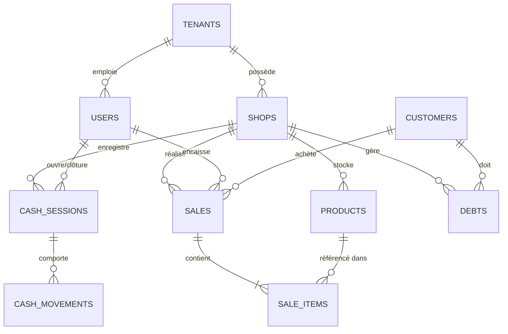

# 02 — Base de Données, Schéma Relationnel & Migrations

Ce document détaille la structure de la base de données PostgreSQL (hébergée via **Supabase**), le schéma relationnel, les politiques de sécurité par ligne (RLS) et l'historique des 59 migrations SQL.

---

## 1. Principes de Conception de la Base de Données

1. **Isolation Multi-Tenants & Multi-Boutiques** :
   Chaque table de données applicative intègre obligatoirement les colonnes de cloisonnement :
   - `tenant_id UUID NOT NULL REFERENCES tenants(id) ON DELETE CASCADE`
   - `shop_id UUID / VARCHAR REFERENCES shops(id)` (lorsque la donnée est propre à un point de vente précis).
2. **Support Intégral Offline-First** :
   - `id UUID PRIMARY KEY DEFAULT gen_random_uuid()` : Les identifiants sont des UUIDv4 générés côté client (Flutter) ou côté serveur, éliminant les collisions lors des créations de données hors-ligne.
   - `created_at TIMESTAMPTZ DEFAULT NOW()`
   - `updated_at TIMESTAMPTZ DEFAULT NOW()` : Indexé systématiquement pour alimenter les requêtes de synchronisation différentielle (deltas).
   - `deleted_at TIMESTAMPTZ NULL` : Suppression logique (Soft Delete) permettant aux clients hors-ligne de savoir qu'un enregistrement a été supprimé sur le serveur lors de la synchronisation.
   - `version INT DEFAULT 1` : Incrémenté à chaque modification pour la détection des conflits (Optimistic Locking).

---

## 2. Vue d'Ensemble des Tables Majeures



### 2.1 Organisation & Sécurité
- **`tenants`** : Compte entreprise/organisation (nom, statut d'abonnement, devise principale par défaut `XOF`, configuration).
- **`shops`** : Magasins physiques, boutiques de marché ou entrepôts rattachés à un tenant (nom, localisation, adresse, téléphone, statut actif).
- **`users`** : Comptes d'accès (nom, prénom, téléphone, hash mot de passe bcrypt, hash PIN gérant à 4 chiffres, statut).
- **`roles` & `permissions` & `role_permissions`** : Matrice RBAC (Admin, Gérant/Owner, Caissier, Auditeur, etc.).
- **`user_shop_assignments`** : Affectation des utilisateurs à une ou plusieurs boutiques avec un rôle spécifique.
- **`refresh_tokens` & `user_sessions`** : Sessions actives des appareils (mobile, desktop), empreinte matérielle, token de rafraîchissement.

### 2.2 Catalogue & Inventaire
- **`categories`** : Catégories de produits avec code couleur, icône et position hiérarchique.
- **`products`** : Référentiel article (nom, code-barres / SKU, prix d'achat moyen pondéré PAMP, prix de vente gros, prix de vente détail, seuil d'alerte stock, unité de mesure).
- **`shop_products` / `inventory_stocks`** : Quantité en stock par boutique et valorisation du stock local.
- **`stock_movements`** : Historique inaltérable des entrées, sorties, ajustements d'inventaire, pertes ou casses.
- **`inventory_lots`** : Suivi des lots de marchandises avec dates d'expiration (DLC/DLUO) et numéros de lot.
- **`stock_transfers` & `stock_transfer_items`** : Flux de transfert de marchandises d'une boutique émettrice vers une boutique réceptrice avec états (Demandé, Expédié, Reçu, Rejeté).

### 2.3 Ventes, Encaissements & Commandes
- **`sales`** : En-tête de vente (numéro de ticket séquentiel, date/heure, total brut, remise accordée, montant net payé, reliquat crédit, mode de paiement principal : Espèces, MoMo, Moov, Chèque, Virement, Crédit).
- **`sale_items`** : Lignes d'articles d'une vente (produit, quantité vendue, prix unitaire appliqué, remise ligne, coût d'achat à l'instant T pour calcul de marge brute).
- **`sales_orders` & `sales_order_deliveries`** : Commandes clients différées, réservations d'articles, livraisons partielles et acomptes.

### 2.4 Caisse & Trésorerie
- **`cash_sessions`** :
  - `id UUID PRIMARY KEY`
  - `shop_id UUID NOT NULL`
  - `user_id UUID NOT NULL` (caissier)
  - `opened_at TIMESTAMPTZ NOT NULL`
  - `closed_at TIMESTAMPTZ NULL`
  - `opening_cash_amount DECIMAL(15,2) NOT NULL` (fond de caisse initial)
  - `expected_cash_amount DECIMAL(15,2)` (solde théorique calculé)
  - `actual_cash_amount DECIMAL(15,2)` (solde réel compté physiquement par le caissier)
  - `discrepancy_amount DECIMAL(15,2)` (écart = réel - attendu)
  - `discrepancy_reason TEXT` (justification obligatoire de l'écart)
  - `status VARCHAR(20)` (`OPEN`, `CLOSED`, `PENDING_APPROVAL`, `CANCELLED`)
  - `verified_by_user_id UUID NULL` (gérant ayant validé l'écart avec son PIN)
  - `verified_at TIMESTAMPTZ NULL`
- **`cash_movements`** : Mouvements ponctuels d'espèces au cours d'une session :
  - `type` (`INTAKE` = apport en cours de journée, `DROP` = versement coffre ou prélèvement pour banque, `EXPENSE` = règlement direct d'une dépense en caisse)
  - `amount DECIMAL(15,2)`
  - `reason TEXT`

### 2.5 Dettes, Clients & Recouvrements
- **`customers`** : Base de données clients (nom, numéro de téléphone WhatsApp pour relances, adresse, plafond maximal de crédit autorisé, statut solvable/contentieux).
- **`debts`** : Créances clients liées ou non à un ticket de vente :
  - `total_amount DECIMAL(15,2)` : Montant initial de la dette.
  - `remaining_amount DECIMAL(15,2)` : Solde restant dû.
  - `due_date DATE` : Échéance de règlement convenue.
  - `status` (`ACTIVE`, `OVERDUE`, `PAID`, `CANCELLED`, `WRITTEN_OFF`).
- **`debt_payments`** : Historique des remboursements (acomptes partiels ou solde complet, mode de paiement, reçu généré).

### 2.6 Abonnements, Mises à Jour & Audit
- **`subscriptions` & `subscription_history`** : Statut d'abonnement du tenant (Plan Free, Standard, Pro, Illimité, date d'échéance, quota de boutiques, quota d'utilisateurs).
- **`app_updates`** : Référentiel des versions logicielles de l'application (Android APK, Windows EXE), numéro de version, hash MD5/SHA256, URL de téléchargement direct, changelog, caractère obligatoire ou optionnel.
- **`audit_logs`** : Journal d'audit de sécurité inviolable (horodatage, utilisateur, action, ressource, payload avant/après, IP, boutique).

---

## 3. Politiques RLS (Row-Level Security)

Sur PostgreSQL Supabase, le RLS garantit qu'un utilisateur ne peut en aucun cas lire ou modifier les données d'un autre tenant, même en cas de mauvaise requête :

```sql
-- Exemple de politique de sécurité par ligne sur la table sales
ALTER TABLE sales ENABLE ROW LEVEL SECURITY;

CREATE POLICY tenant_isolation_sales ON sales
    FOR ALL
    USING (tenant_id = auth.jwt() ->> 'tenant_id')
    WITH CHECK (tenant_id = auth.jwt() ->> 'tenant_id');
```

---

## 4. Index de Performance pour la Synchronisation

Pour assurer une synchronisation quasi-instantanée sur des bases de données volumineuses, des index B-Tree composites sont appliqués :

```sql
CREATE INDEX idx_products_sync ON products (shop_id, updated_at DESC);
CREATE INDEX idx_sales_sync ON sales (shop_id, updated_at DESC);
CREATE INDEX idx_cash_sessions_sync ON cash_sessions (shop_id, updated_at DESC);
CREATE INDEX idx_debts_sync ON debts (shop_id, updated_at DESC);
CREATE INDEX idx_stock_movements_sync ON stock_movements (shop_id, updated_at DESC);
```

