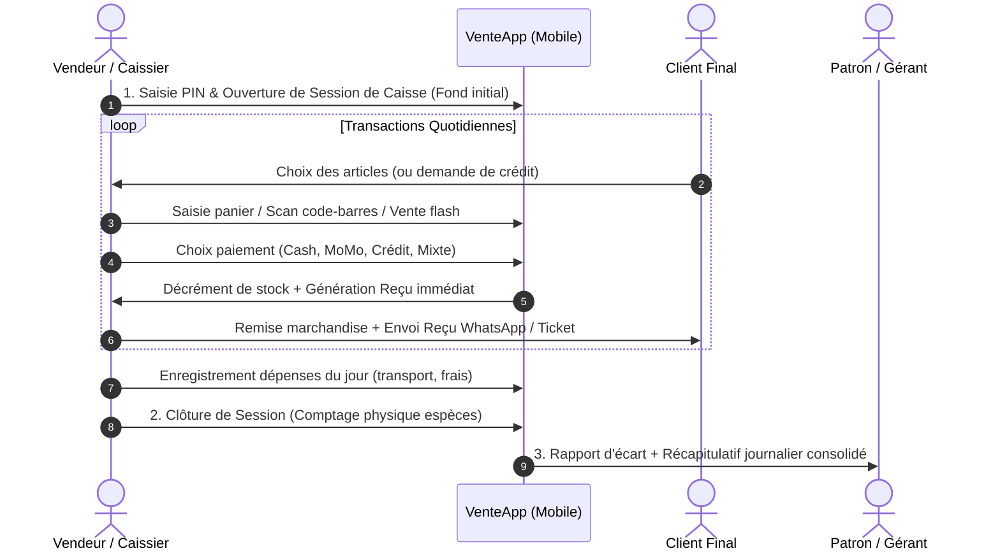

# Cahier des Charges Fonctionnel & Technique — VenteApp (ARIKE)

---

## 1. Introduction & Objet du Document

Le présent **Cahier des Charges (CdC)** définit de manière formelle et exhaustive l'ensemble des exigences fonctionnelles, techniques, ergonomiques et organisationnelles de la solution **VenteApp (ARIKE)**. Il sert de contrat de référence entre la maîtrise d'ouvrage (Product Owner / Représentants métier) et l'équipe de réalisation logicielle (Développeurs Mobile, Backend, Frontend et QA).

---

## 2. Expression Détaillée des Besoins Métier

### 2.1 Le Cycle Quotidien du Point de Vente
Le commerçant et ses employés opèrent selon un rituel commercial structuré que l'application doit soutenir sans aucune friction :



### 2.2 Synthèse des Grands Domaines Métier

1. **Sécurité d'Accès & Profils** : Verrouillage strict par code PIN, déverrouillage biométrique, expiration automatique de session et séparation des droits patron/employés.
2. **Caisse & Encaissement Rapide** : Saisie en moins de 3 secondes, support des ventes standard (panier détaillé) et express (montant global), calcul instantané de la monnaie à rendre, gestion des remises.
3. **Gestion des Dettes & Recouvrement** : Création automatique d'une créance pour toute vente à crédit, historique chronologique des acomptes, calcul en temps réel du solde débiteur, relances automatiques pré-formatées pour WhatsApp, procédure encadrée de pardon de dette.
4. **Sessions de Caisse (Cash Management)** : Ouverture avec déclaration du fond de caisse, suivi des mouvements d'espèces intra-journée, clôture avec double comptage et calcul des écarts (excédent / déficit).
5. **Inventaire, Lots & Alertes** : Suivi des quantités en stock, valorisation au coût d'achat et au prix de vente, gestion des numéros de lots et dates de péremption, alertes visuelles de stock faible, mouvements tracés (réapprovisionnement, perte, casse, inventaire).
6. **Approvisionnements & Fournisseurs (Procurement)** : Gestion des commandes d'achat, réceptions partielles ou totales, bons de refus pour non-conformité et mise à jour automatique des prix de revient.
7. **Transferts Inter-Boutiques** : Expédition de marchandises entre dépôts/points de vente, statut en transit, réception avec contrôle contradictoire et ajustement automatique des stocks émetteur/récepteur.
8. **Commandes Clients & Livraisons** : Prise de commande préalable, préparation en magasin, gestion des reliquats et bons de livraison.
9. **Bureau de Change (FX Exchange)** : Achat et vente de devises sous-régionales et internationales (XOF, NGN, EUR, USD), gestion des taux appliqués par session et calcul du bénéfice de change.
10. **Pilotage, Statistiques & Audit** : Chiffre d'affaires en temps réel, marge bénéficiaire brute/nette, top produits, taux de recouvrement des créances, et journal d'audit immuable de toutes les actions sensibles.

---

## 3. Matrice des Exigences Fonctionnelles (EF)

Les exigences sont classées par priorité selon la méthode MoSCoW :
- **M** (*Must have*) : Indispensable pour la livraison V1/V2.
- **S** (*Should have*) : Fortement recommandé, prévu en V2/V3.
- **C** (*Could have*) : Optionnel ou valeur ajoutée future.
- **W** (*Won't have for now*) : Hors périmètre actuel.

### 3.1 Authentification, Sécurité & Sessions

| Réf | Description de l'Exigence | Priorité | Version |
| :--- | :--- | :---: | :---: |
| **EF-AUTH-01** | Authentification obligatoire par code PIN numérique (4 à 6 chiffres). | **M** | V1 |
| **EF-AUTH-02** | Stockage sécurisé du PIN sous forme de hash bcrypt (facteur de coût 10). | **M** | V1 |
| **EF-AUTH-03** | Support de l'authentification biométrique (empreinte digitale / Face ID). | **S** | V1 |
| **EF-AUTH-04** | Verrouillage automatique de l'application après 5 minutes d'inactivité. | **M** | V1 |
| **EF-AUTH-05** | Blocage temporaire de 15 minutes après 5 échecs consécutifs de saisie du PIN. | **M** | V1 |
| **EF-AUTH-06** | Procédure de secours via fichier de récupération d'urgence chiffré. | **M** | V1 |
| **EF-AUTH-07** | Traçabilité de toute tentative de déblocage d'urgence dans le journal d'audit. | **M** | V1 |

### 3.2 Gestion des Ventes & Encaissement

| Réf | Description de l'Exigence | Priorité | Version |
| :--- | :--- | :---: | :---: |
| **EF-VTE-01** | Saisie d'une vente en **Mode Standard** avec ajout de produits au panier. | **M** | V1 |
| **EF-VTE-02** | Saisie d'une vente en **Mode Rapide** (saisie directe du montant sans sélection de produit). | **M** | V1 |
| **EF-VTE-03** | Scan de code-barres (EAN-13, QR Code) via la caméra du smartphone. | **S** | V1 |
| **EF-VTE-04** | Application d'une remise commerciale globale ou par ligne d'article (en montant FCFA). | **M** | V1 |
| **EF-VTE-05** | Modes de règlement multiples : Espèces, MTN MoMo, Moov Money, Crédit, Paiement Mixte. | **M** | V1 |
| **EF-VTE-06** | Calcul instantané de la monnaie à rendre en cas de paiement en espèces supérieur au total. | **M** | V1 |
| **EF-VTE-07** | Génération immédiate d'un reçu numérique unique (format `REC-YYYYMMDD-NNNN`). | **M** | V1 |
| **EF-VTE-08** | Partage direct du reçu via WhatsApp et impression thermique Bluetooth ESC/POS. | **M** | V1 |
| **EF-VTE-09** | Annulation d'une vente possible uniquement dans les 24h par le Patron avec motif obligatoire. | **M** | V1 |
| **EF-VTE-10** | Décrément automatique du stock en temps réel lors de la validation d'une vente standard. | **M** | V1 |
| **EF-VTE-11** | Gestion des grilles tarifaires différenciées (prix détail, demi-gros, gros). | **S** | V2 |

### 3.3 Dettes Clients & Recouvrement

| Réf | Description de l'Exigence | Priorité | Version |
| :--- | :--- | :---: | :---: |
| **EF-DET-01** | Création automatique d'une dette lors d'une vente avec montant à crédit > 0. | **M** | V1 |
| **EF-DET-02** | Obligation d'associer un client préalablement enregistré pour toute vente à crédit. | **M** | V1 |
| **EF-DET-03** | Enregistrement d'acomptes et remboursements partiels avec mise à jour du solde restant. | **M** | V1 |
| **EF-DET-04** | Clôture automatique de la dette au statut `payée` lorsque le solde atteint 0 FCFA. | **M** | V1 |
| **EF-DET-05** | Génération d'un reçu d'acompte partageable par WhatsApp avec rappel du solde restant dû. | **M** | V1 |
| **EF-DET-06** | Envoi en 1 clic d'un message WhatsApp de relance pré-formaté et poli. | **M** | V1 |
| **EF-DET-07** | Fonctionnalité de pardon de dette (*forgiven*) réservée au Patron avec motif obligatoire (min 10 car.). | **M** | V1 |
| **EF-DET-08** | Timeline chronologique exhaustive des remboursements et modifications d'une dette. | **M** | V1 |
| **EF-DET-09** | Filtre dédié "Dettes critiques" (créances sans mouvement depuis plus de 30 jours). | **M** | V1 |

### 3.4 Inventaire, Lots & Alertes Stock

| Réf | Description de l'Exigence | Priorité | Version |
| :--- | :--- | :---: | :---: |
| **EF-INV-01** | Gestion du catalogue produits : nom, catégorie, unité, prix de vente, prix d'achat, photo. | **M** | V1 |
| **EF-INV-02** | Impossibilité absolue d'enregistrer un stock négatif (garde-fou applicatif et base). | **M** | V1 |
| **EF-INV-03** | Configuration d'un seuil d'alerte de stock faible par produit (défaut : 5 unités). | **M** | V1 |
| **EF-INV-04** | Mouvements de stock manuels tracés avec motif obligatoire (réapprovisionnement, perte, casse, correction). | **M** | V1 |
| **EF-INV-05** | Suivi par numéro de lot et date limite de consommation / péremption (DLC). | **S** | V2 |
| **EF-INV-06** | Archivage logique (*soft delete*) des produits supprimés pour préserver l'historique comptable. | **M** | V1 |

### 3.5 Sessions de Caisse & Gestion des Dépenses

| Réf | Description de l'Exigence | Priorité | Version |
| :--- | :--- | :---: | :---: |
| **EF-CS-01** | Ouverture obligatoire de session de caisse avec saisie du fond initial. | **M** | V2 |
| **EF-CS-02** | Enregistrement des entrées/sorties exceptionnelles de liquidités en cours de journée. | **M** | V2 |
| **EF-CS-03** | Enregistrement des dépenses courantes d'exploitation avec catégorisation et justificatif. | **M** | V2 |
| **EF-CS-04** | Clôture de caisse avec saisie du comptage physique des billets/pièces et calcul automatique de l'écart. | **M** | V2 |
| **EF-CS-05** | Génération d'un ticket de clôture journalière (Z de caisse) consolidé. | **M** | V2 |

### 3.6 Approvisionnements, Transferts & Supply Chain

| Réf | Description de l'Exigence | Priorité | Version |
| :--- | :--- | :---: | :---: |
| **EF-SUP-01** | Création et suivi des bons de commande fournisseurs. | **S** | V3 |
| **EF-SUP-02** | Réception de livraison avec pointage des quantités et saisie des motifs de refus. | **S** | V3 |
| **EF-SUP-03** | Expédition de transferts inter-boutiques avec génération de bordereau d'expédition. | **S** | V3 |
| **EF-SUP-04** | Réception contradictoire du transfert par la boutique destinataire avec gestion des écarts de transport. | **S** | V3 |

### 3.7 Bureau de Change (FX Exchange)

| Réf | Description de l'Exigence | Priorité | Version |
| :--- | :--- | :---: | :---: |
| **EF-FX-01** | Gestion des devises étrangères courantes (NGN Naira, EUR Euro, USD Dollar). | **C** | V3 |
| **EF-FX-02** | Définition des cours d'achat et de vente de devises par session de change. | **C** | V3 |
| **EF-FX-03** | Enregistrement instantané des opérations d'achat/vente de devises avec reçu de change. | **C** | V3 |
| **EF-FX-04** | Calcul automatique de la position de change et de la marge brute réalisée. | **C** | V3 |

### 3.8 Notifications Intelligentes & Alertes Sonores

| Réf | Description de l'Exigence | Priorité | Version |
| :--- | :--- | :---: | :---: |
| **EF-NOTIF-01** | Fonctionnement 100% autonome et local des notifications sans dépendance réseau. | **M** | V1 |
| **EF-NOTIF-02** | **Déclenchement Hors-Application** : Programmation des notifications de fond s'affichant même si l'application est totalement fermée. | **M** | V1 |
| **EF-NOTIF-03** | **Signal Sonore & Vibrations** : Émission obligatoire d'un signal sonore distinct et de vibrations audibles sur canal haute importance. | **M** | V1 |
| **EF-NOTIF-04** | Rappel quotidien automatisé des dettes en souffrance et notification du résumé de caisse à 20h00. | **M** | V1 |
| **EF-NOTIF-05** | Routage direct (Deep Linking) lors du clic sur la notification vers l'écran d'action concerné. | **M** | V1 |

### 3.9 Modèle de Licence & Forfait Automatique à l'Installation

| Réf | Description de l'Exigence | Priorité | Version |
| :--- | :--- | :---: | :---: |
| **EF-LIC-01** | **Forfait Gratuit par Défaut** : Attribution automatique du forfait **GRATUIT (Starter)** à **0 FCFA à vie** dès l'installation de l'application. | **M** | V1 |
| **EF-LIC-02** | Périmètre du forfait Gratuit : 1 Boutique, 1 Utilisateur, 100% Offline Local (Ventes, Stocks, Dettes, Reçus WhatsApp/Tickets, Notifications sonores). | **M** | V1 |
| **EF-LIC-03** | Évolution optionnelle et sans engagement vers les forfaits payants Pro (5 000 F/mois) ou Entreprise (15 000 F/mois). | **S** | V2 |

---

## 4. Modèle d'Acteurs & Matrice des Permissions (RBAC)

Le système propose un modèle de contrôle d'accès basé sur les rôles (**Role-Based Access Control - RBAC**) hautement granulaire :

```
┌─────────────────────────────────────────────────────────────────────────┐
│                    HIÉRARCHIE DES RÔLES UTILISATEURS                    │
├─────────────────────────────────────────────────────────────────────────┤
│ 👑 SUPER_ADMIN   : Administration de la plateforme SaaS, tenants, packs │
│ 🏢 OWNER (Patron): Accès total, configuration, audits, pardons, finances│
│ 👔 MANAGER       : Gestion des stocks, achats, approbations de caisse   │
│ 💼 SELLER/CASHIER: Ventes, encaissements, saisie dépenses, consultation │
│ 📦 STOCKIST      : Réception de marchandises, inventaires physiques     │
│ 📊 VIEWER        : Consultation des tableaux de bord en lecture seule   │
└─────────────────────────────────────────────────────────────────────────┘
```

### 4.1 Matrice Détaillée des Droits d'Accès

| Fonctionnalité / Action Métier | OWNER | MANAGER | SELLER | STOCKIST | VIEWER |
| :--- | :---: | :---: | :---: | :---: | :---: |
| **Enregistrer une vente standard / rapide** | ✅ | ✅ | ✅ | ❌ | ❌ |
| **Consulter le catalogue produit et stock** | ✅ | ✅ | ✅ | ✅ | ✅ |
| **Modifier le prix d'un produit** | ✅ | ⚠️ (Si autorisé) | ❌ | ❌ | ❌ |
| **Ajuster le stock manuellement** | ✅ | ✅ | ❌ | ✅ | ❌ |
| **Annuler une vente (< 24h)** | ✅ | ❌ | ❌ | ❌ | ❌ |
| **Consulter les dettes et relancer WhatsApp** | ✅ | ✅ | ✅ | ❌ | ✅ |
| **Pardonner une dette (Geste commercial)** | ✅ | ❌ | ❌ | ❌ | ❌ |
| **Ouvrir et clôturer une session de caisse** | ✅ | ✅ | ✅ | ❌ | ❌ |
| **Consulter les rapports financiers & marges** | ✅ | ⚠️ (Partiel) | ❌ | ❌ | ✅ |
| **Consulter le Journal d'Audit (`audit_logs`)**| ✅ | ❌ | ❌ | ❌ | ❌ |
| **Modifier les paramètres de la boutique** | ✅ | ❌ | ❌ | ❌ | ❌ |
| **Gérer les utilisateurs et vendeurs** | ✅ | ❌ | ❌ | ❌ | ❌ |

---

## 5. Exigences Non-Fonctionnelles (ENF)

### 5.1 Performance & Réactivité
- **Temps de Réponse des Écrans (ENF-PERF-01)** : Toutes les transitions de page et validations d'actions locales doivent s'exécuter en moins de **300 ms** sur un appareil cible (Android 10+, 2 GB RAM).
- **Temps de Saisie Panier (ENF-PERF-02)** : L'ajout d'un article et le recalcul du total doivent prendre moins de **50 ms**.
- **Recherche Instantanée (ENF-PERF-03)** : L'auto-complétion lors de la recherche d'un produit ou d'un client dans une base de 1 000 éléments doit répondre en moins de **100 ms**.
- **Isolates de Calcul (ENF-PERF-04)** : Les traitements lourds (génération PDF, calculs d'agrégation statistique annuelle, compression d'image) doivent impérativement s'exécuter dans un isolate Dart d'arrière-plan pour ne jamais figer le thread UI à 60 fps.

### 5.2 Disponibilité & Résilience Hors-Ligne (Offline-First)
- **Autonomie 100% Locale (ENF-OFF-01)** : Aucune opération de vente, encaissement, gestion de dette, consultation de stock ou clôture de caisse ne doit être bloquée par l'absence de réseau Internet.
- **Persistance Atomique (ENF-OFF-02)** : Chaque transaction commerciale (vente + lignes + mouvement de stock + dette) est exécutée dans une transaction ACID SQLite stricte.
- **Tolérance aux Crashs (ENF-OFF-03)** : En cas d'arrêt brutal de l'appareil (batterie déchargée), le journal WAL (Write-Ahead Logging) garantit l'intégrité de la base sans corruption.

### 5.3 Sécurité, Confidentialité & Traçabilité
- **Chiffrement des Données au Repos (ENF-SEC-01)** : La base SQLite peut être chiffrée via SQLCipher (extension sqlite3mc).
- **Chiffrement des Sauvegardes (ENF-SEC-02)** : Les fichiers d'export `.venteapp` sont chiffrés en **AES-256-GCM** avec dérivation de clé PBKDF2 à partir du code PIN de sécurité.
- **Sécurisation des Communications (ENF-SEC-03)** : Toutes les requêtes vers le Backend NestJS transitent obligatoirement par **HTTPS / TLS 1.3**.
- **Isolation Multi-Tenants (ENF-SEC-04)** : Les données cloud sont isolées hermétiquement au niveau PostgreSQL via le mécanisme de **Row Level Security (RLS)** sur les colonnes `tenant_id` et `shop_id`.
- **Immutabilité de l'Audit (ENF-SEC-05)** : Les enregistrements de la table `audit_logs` sont en mode *append-only* strict ; aucune requête de mise à jour (`UPDATE`) ou de suppression (`DELETE`) n'est autorisée.

### 5.4 Ergonomie, UX & Accessibilité
- **Taille des Zones Tactiles (ENF-UX-01)** : Les boutons et éléments interactifs respectent une taille minimale de **48 × 48 dp** pour une manipulation facile d'une seule main.
- **Typographie & Lisibilité (ENF-UX-02)** : Police moderne (Outfit / Inter), taille de texte minimale de 14sp, avec contrastes respectant le niveau **WCAG AA** (ratio minimum 4.5:1).
- **Affichage Monétaire Homogène (ENF-UX-03)** : Les montants sont obligatoirement formatés avec séparateurs d'espaces pour les milliers (ex: `15 000 FCFA`) et sans décimales.
- **Thème Sombre & Économie d'Énergie (ENF-UX-04)** : Support complet du mode sombre pour soulager la batterie sur les écrans AMOLED et améliorer la lisibilité en plein soleil ou en pénombre.

---

## 6. Contraintes d'Interfaçage & Périphériques

```
┌────────────────────────────────────────────────────────────────────────┐
│               ÉCOSYSTÈME DE PÉRIPHÉRIQUES SUPPORTÉS                    │
├─────────────────────────┬──────────────────────────────────────────────┤
│ 🖨️ Imprimantes          │ Imprimantes thermiques Bluetooth 58mm / 80mm │
│    Thermiques           │ Protocole ESC/POS standard                   │
├─────────────────────────┼──────────────────────────────────────────────┤
│ 📷 Scan Code-Barres     │ Caméra intégrée via mobile_scanner           │
│                         │ Douchettes Bluetooth HID (optionnel)         │
├─────────────────────────┼──────────────────────────────────────────────┤
│ 💬 Messagerie           │ Intégration directe WhatsApp via URL Scheme  │
│                         │ `https://wa.me/{phone}?text={message}`       │
├─────────────────────────┼──────────────────────────────────────────────┤
│ 📄 Export Documents     │ Génération native PDF (Reçus, Z de caisse,   │
│                         │ Rapports financiers, Grand livre de dettes)  │
└─────────────────────────┴──────────────────────────────────────────────┘
```

---

## 7. Critères d'Acceptation & Recette Globale

La validation formelle du logiciel repose sur la satisfaction complète des critères suivants :
1. **Zéro Régression de Stock** : Chaque vente décrémente exactement le stock disponible ; chaque annulation restitue exactement la quantité.
2. **Exactitude Financière** : Pour toute vente, l'égalité comptable `Montant Encaissé + Montant Crédit = Montant Total Vente` est vérifiée à 100%.
3. **Réconciliation Additive de Dette** : En cas de saisie concurrente hors-ligne de deux acomptes sur une même dette, la synchronisation cumule les deux remboursements sans perte de centime.
4. **Zéro Écran Blanc / Zéro Spinner Bloquant** : En mode déconnecté, la navigation dans tous les modules métier s'effectue sans aucune latence ni alerte d'erreur réseau intempestive.
