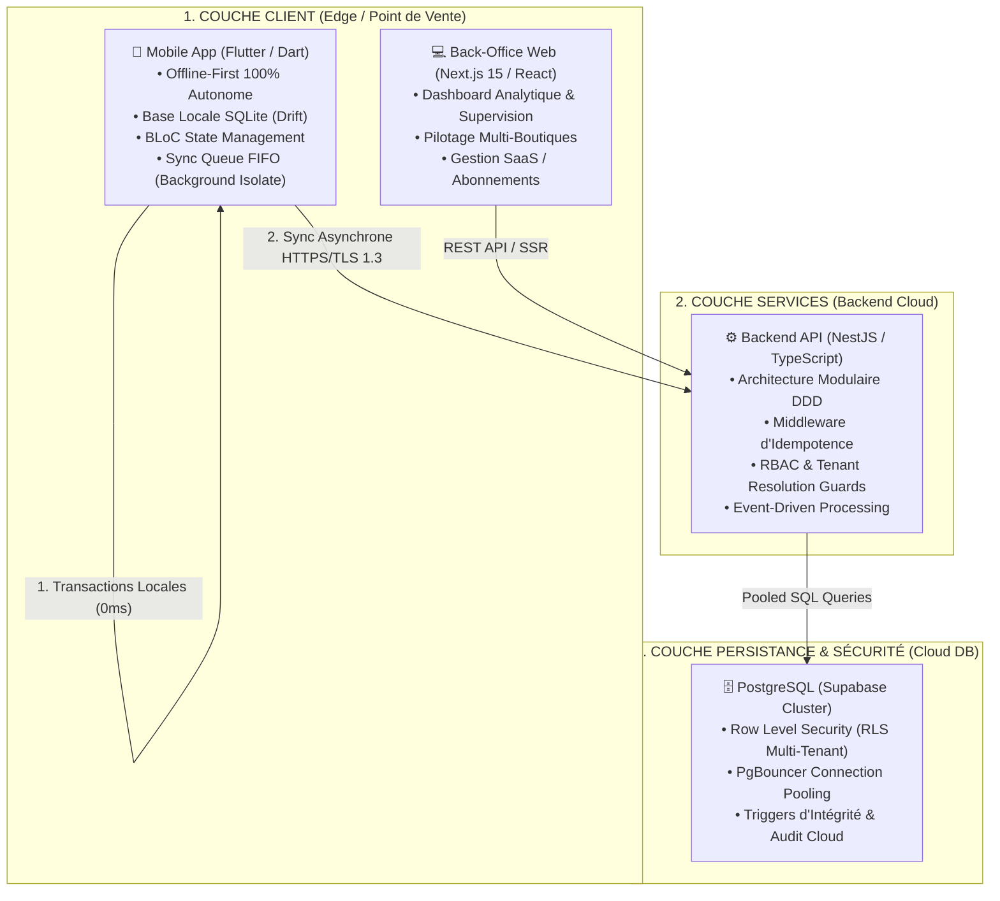
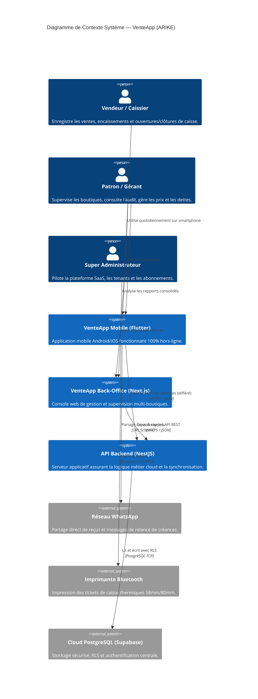
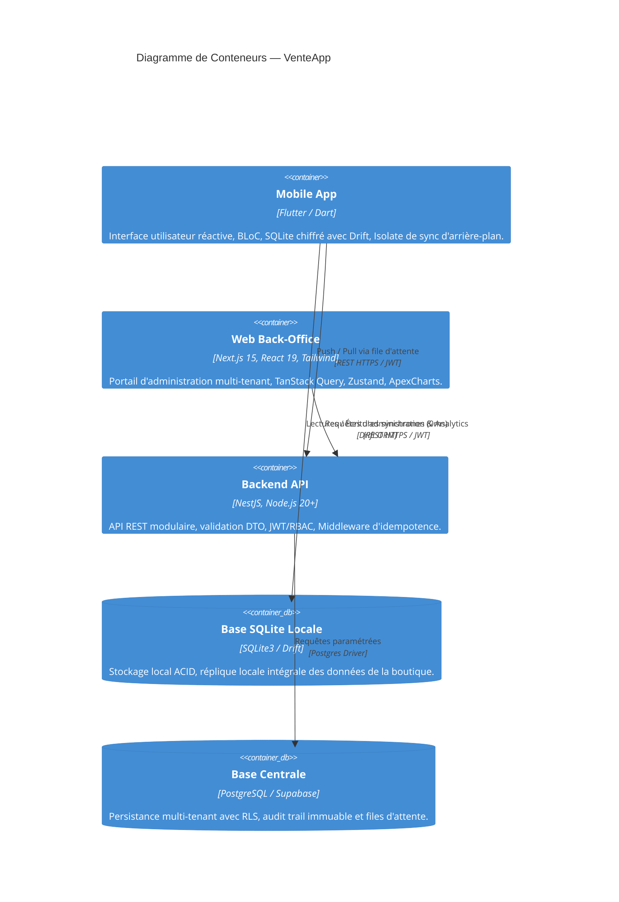
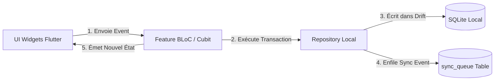
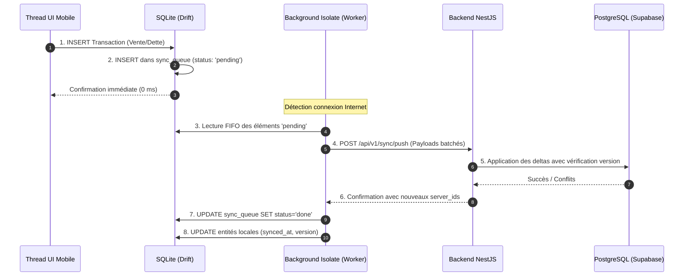

# Architecture Technique Globale — VenteApp (ARIKE)

---

## 1. Vue d'Ensemble & Principes Directeurs

Le système **VenteApp (ARIKE)** repose sur une architecture **3-Tiers Offline-First & Multi-Plateforme**, combinant l'extrême réactivité d'une base embarquée locale sur mobile avec la puissance et l'extensibilité d'un backend cloud multi-tenant et d'un portail web de gestion.



---

## 2. Diagrammes d'Architecture C4

### 2.1 Diagramme de Contexte (Niveau 1)


### 2.2 Diagramme de Conteneurs (Niveau 2)


---

## 3. Architecture Mobile (Flutter Offline-First)

### 3.1 Découpage Logiciel & Clean Architecture
L'application Flutter est structurée selon les principes de la **Clean Architecture** et du **Domain-Driven Design (DDD)** :

```
lib/
├── app/                  # Configuration racine, thèmes, injection de dépendances (GetIt)
├── core/                 # Briques transversales non liées au métier
│   ├── database/         # Schéma Drift, migrations, DAOs, connexions chiffrées
│   ├── network/          # Client Dio, intercepteurs JWT, détection réseau
│   ├── security/         # Chiffrement AES-GCM, PBKDF2, stockage sécurisé
│   ├── sync/             # Moteur de synchronisation, gestionnaire de queue FIFO
│   └── errors/           # Exceptions typées et échecs applicatifs
├── features/             # Modules métier verticaux (Feature-First)
│   ├── auth/             # BLoC, pages PIN/Biométrie, repositories
│   ├── dashboard/        # Widgets KPI temps réel
│   ├── inventory/        # Catalogue, fiches produits, ajustements, lots
│   ├── sales/            # Panier standard, vente rapide, scan code-barres
│   ├── debts/            # Créances, acomptes, pardon de dette, relances
│   ├── cash_sessions/    # Ouverture/clôture caisse, contrôle d'écarts
│   ├── expenses/         # Saisie des charges et justificatifs photo
│   ├── stock_transfer/   # Expéditions et réceptions inter-boutiques
│   ├── procurement/      # Commandes et réceptions fournisseurs
│   ├── fx_exchange/      # Bureau de change et taux de session
│   ├── audit/            # Consultation du journal d'audit
│   └── settings/         # Configuration, sauvegardes, profils
└── shared/               # Widgets réutilisables, composants graphiques, formatters
```

### 3.2 Modèle de Gestion d'État (BLoC / Cubit)
Le pattern **BLoC (Business Logic Component)** garantit une séparation stricte entre l'interface utilisateur et la logique métier :
- **Events** : Événements utilisateurs immuables émis depuis la vue (ex: `AddProductToCartEvent`, `SubmitPaymentEvent`, `ForgiveDebtEvent`).
- **States** : États d'interface émis de façon unidirectionnelle (ex: `CartStateLoaded`, `SaleProcessingState`, `SaleSuccessState`).
- **BlocObserver** : Observateur global pour le monitoring et la traçabilité des erreurs d'état en temps réel.



---

## 4. Architecture Backend (NestJS Multi-Tenant)

### 4.1 Modularité & Inversion de Contrôle
Le serveur Backend est développé en **NestJS (TypeScript)** selon une architecture hautement modulaire. Chaque domaine métier est encapsulé dans son propre module (`Controller`, `Service`, `Repository`, `DTOs`).

```
src/
├── core/                 # Infrastructure transverse
│   ├── database/         # Client Supabase/PostgreSQL avec RLS
│   ├── security/         # JWT Strategy, Refresh Tokens, RBAC Guards
│   ├── idempotency/      # Idempotency Middleware (clé unique)
│   ├── cache/            # Cache mémoire et invalidation d'événements
│   └── monitoring/       # Intercepteurs de logging structuré et métriques
├── modules/              # Modules métier verticaux
│   ├── auth/             # Authentification JWT, PIN, WhatsApp OTP
│   ├── tenants/          # Gestion hermétique des organisations
│   ├── shops/            # Boutiques et affectations utilisateurs
│   ├── users/            # Gestion des comptes et profils
│   ├── rbac/             # Gestion fine des rôles et permissions
│   ├── inventory/        # Catalogue, lots et mouvements de stock
│   ├── sales/            # Enregistrement, annulation et remplacements
│   ├── payments/         # Traitement des encaissements
│   ├── debts/            # Suivi des créances et remboursements
│   ├── cash-sessions/    # Gestion des sessions et clôtures de caisse
│   ├── expenses/         # Charges d'exploitation
│   ├── procurement/      # Achats et réceptions fournisseurs
│   ├── stock-transfers/  # Transferts inter-boutiques
│   ├── fx-exchange/      # Bureau de change et taux
│   ├── calculators/      # Simulateurs commerciaux
│   ├── reports/          # Rapports financiers consolidés
│   ├── audit/            # Journal d'audit centralisé
│   └── licensing/        # Licences SaaS et abonnements
└── main.ts               # Point d'entrée, Swagger, validation globale
```

### 4.2 Middleware d'Idempotence
Pour éviter tout risque de double transaction lors de renvois réseau automatiques, le middleware d'idempotence vérifie le header `Idempotency-Key` :
- Si la clé est déjà connue pour le même tenant, la réponse mise en cache est immédiatement retournée sans réexécuter l'action en base.
- Si la clé est nouvelle, la transaction s'exécute et le résultat est persisté dans `idempotency_records`.

---

## 5. Moteur de Synchronisation Cloud & Résolution des Conflits

### 5.1 Pipeline de Synchronisation en 3 Étapes
La synchronisation repose sur un modèle **Push/Pull asynchrone non-bloquant** :



### 5.2 Stratégie Différenciée de Résolution des Conflits

| Type de Donnée | Stratégie Appliquée | Règle de Résolution | Justification Métier |
| :--- | :---: | :--- | :--- |
| **Données Financières**<br/>*(Remboursements dettes, acomptes, règlements)* | **Fusion Additive (Delta-Event)** | Le serveur rejoue chaque paiement individuellement : les montants sont cumulés, le solde restant est recalculé comme la somme des deltas. | **Zéro perte d'argent** : si patron et vendeur enregistrent chacun 5 000 F d'acompte hors-ligne, 10 000 F sont comptabilisés. |
| **Mouvements de Stock**<br/>*(Ventes, réapprovisionnements, pertes)* | **Journal Append-Only** | Chaque mouvement est inséré avec son delta (+/- Qty). La quantité finale correspond à la somme arithmétique de tous les mouvements. | Prévient l'écrasement d'une vente par une entrée en stock concurrente. |
| **Données Descriptives**<br/>*(Nom produit, seuil alerte, note client)* | **Last-Write-Wins (LWW)** | La version ayant le timestamp `updated_at` le plus récent l'emporte. | Les métadonnées textuelles ne présentent pas de risque comptable critique. |
| **Conflits Ambigus / Prix**<br/>*(Modification contradictoire d'un tarif)* | **Arbitrage Manuel (Patron)** | La ligne passe en `sync_status = 'conflict'`. Un écran dédié sur le mobile du Patron affiche les deux versions côte à côte. | Le Patron conserve le contrôle souverain sur sa politique tarifaire. |

---

## 6. Architecture de Sécurité, Chiffrement & Isolation

```
┌──────────────────────────────────────────────────────────────────────────┐
│                   DISPOSITIF DE SÉCURITÉ MULTI-NIVEAUX                   │
├─────────────────────────┬────────────────────────────────────────────────┤
│ 🔐 Chiffrement au Repos │ Base locale SQLite chiffrée via SQLCipher.     │
│    (Mobile)             │ Sauvegardes .venteapp chiffrées en AES-256-GCM.│
├─────────────────────────┼────────────────────────────────────────────────┤
│ 🛡️ Hachage des Secrets  │ Code PIN haché avec bcrypt (coût 10).          │
│                         │ Clés stockées dans flutter_secure_storage.     │
├─────────────────────────┼────────────────────────────────────────────────┤
│ 🌐 Chiffrement Transit  │ Toutes communications en HTTPS / TLS 1.3.      │
│                         │ Headers d'autorisation Bearer JWT signés SHA256│
├─────────────────────────┼────────────────────────────────────────────────┤
│ 🏢 Isolation Cloud      │ PostgreSQL Row Level Security (RLS) :          │
│    (Multi-Tenant)       │ Chaque requête est bornée à `tenant_id`        │
│                         │ et `shop_id` sans fuite de données possible.   │
├─────────────────────────┼────────────────────────────────────────────────┤
│ 📜 Immutabilité Audit   │ Journal d'audit `audit_logs` en mode lecture/  │
│                         │ insertion seule (aucun UPDATE/DELETE permis).  │
└─────────────────────────┴────────────────────────────────────────────────┘
```

---

## 7. Architecture Web Back-Office (Next.js 15)

Le portail de supervision est développé avec **Next.js 15 (App Router)** et **React 19** :
- **Server-Side Rendering (SSR) & Server Components** : Chargement ultra-rapide des tableaux de bord initiaux.
- **Client Components & TanStack Query (v5)** : Mises à jour en temps réel des données de caisse, invalidation granulaire du cache et requêtes optimisées.
- **Zustand** : Gestion centralisée de l'état de navigation, de la boutique active sélectionnée et de la session utilisateur.
- **Tailwind CSS & ApexCharts** : Design responsive adapté aux écrans d'ordinateur de bureau, tablettes et ordinateurs portables, avec graphiques d'analyse financière interactifs.
