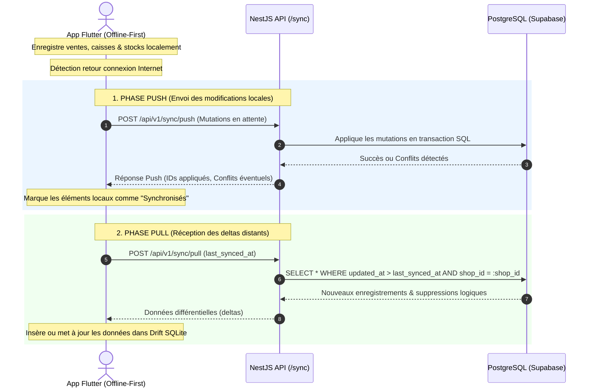

# 05 — Moteur de Synchronisation Offline-First

Ce document explique le protocole et les mécanismes du moteur de synchronisation bidirectionnelle du backend de **ARIKE (VenteApp)**, assurant la cohérence des données entre les terminaux mobiles/desktop et le cloud.

---

## 1. Principes Fondamentaux de la Synchronisation

Dans les marchés africains (Dantokpa, Ouando, Ganhi) ou les zones péri-urbaines, la connexion Internet est fréquemment intermittente ou absente. ARIKE applique une approche **Offline-First intégrale** :

1. **Autonomie Locale Totale** : Le terminal client enregistre toutes les opérations dans sa base de données locale (Drift SQLite) sans jamais attendre de réponse réseau.
2. **Identification Décentralisée** : Tous les identifiants d'enregistrements sont des UUIDv4 générés par le terminal. Il n'y a aucun ID auto-incrémenté serveur qui bloquerait la création hors-ligne.
3. **Idempotence des Écritures** : Chaque lot envoyé au serveur (`batch_id`) est idempotent. Si une connexion coupe au milieu d'un envoi, le client peut renvoyer le lot sans risque de doublons.

---

## 2. Le Protocole de Synchronisation



---

## 3. Stratégies de Résolution des Conflits

Lorsque plusieurs terminaux modifient simultanément les mêmes ressources en mode déconnecté, le backend applique des règles de résolution déterministes :

### 3.1 Ventes & Mouvements de Caisse : "Append-Only" (Pas de conflit)
Les ventes (`sales`) et les mouvements de caisse (`cash_movements`) sont des enregistrements immuables. Ils ne sont jamais mis à jour, uniquement ajoutés. Par conséquent, il n'y a aucun conflit possible lors de leur agrégation sur le serveur.

### 3.2 Mouvements de Stock : Application Relative (Delta Decrement)
Si l'appareil A vend 2 unités de l'article X hors-ligne et que l'appareil B vend 3 unités du même article X hors-ligne :
- Le serveur **n'écrase pas** la quantité absolue par la valeur de A ou de B.
- Le serveur applique la **variation relative** : `stock = stock - 2` puis `stock = stock - 3`.
- Résultat final : décrémentation exacte de 5 unités.
- Si le stock passe en négatif (rupture physique constatée), un drapeau `insufficient_stock_warning` est levé dans le journal d'audit sans bloquer la clôture financière.

### 3.3 Clients & Produits : Last-Write-Wins (LWW) avec Sanity Check
Pour les informations signalétiques (ex : modification du nom d'un produit ou du numéro de téléphone d'un client) :
- La règle appliquée est **LWW (Last-Write-Wins)** basée sur l'horodatage client vérifié par la fenêtre de cohérence serveur (tolérance de dérive d'horloge de ±15 minutes).
- Le numéro de version (`version = version + 1`) est incrémenté.

### 3.4 Propagations des Suppressions (Soft Delete)
Pour supprimer une entité, le client n'exécute pas de `DELETE FROM`. Il met à jour la colonne `deleted_at = NOW()`.
Lors du `pull`, le backend renvoie :
```json
{
  "id": "prod-uuid-99",
  "deleted_at": "2026-11-17T14:02:11.000Z"
}
```
L'application Flutter supprime alors l'article correspondant de sa base SQLite locale.

