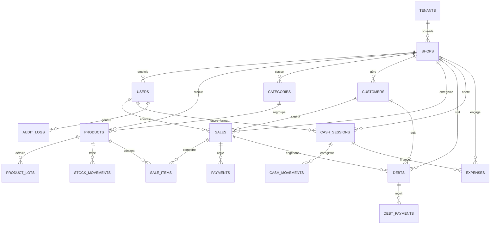

# Modélisation Complète de la Base de Données — VenteApp (ARIKE)

---

## 1. Introduction & Principes de Conception

La modélisation de la base de données de **VenteApp (ARIKE)** est conçue pour garantir une cohérence transactionnelle absolue, une exécution ultra-rapide en mode hors-ligne local (SQLite via Drift) et une réplication fluide vers le cloud centralisé (PostgreSQL sous Supabase).

### 1.1 Principes Directeurs
1. **Intégrité Référentielle Forte** : Toutes les relations sont formalisées avec des clés étrangères (`FOREIGN KEY`), assorties d'actions `ON DELETE RESTRICT` ou `ON DELETE CASCADE` explicites.
2. **Historisation Immuable (*Append-Only*)** : Les flux de caisse, les mouvements de stock et les entrées du journal d'audit ne sont jamais mis à jour (`UPDATE`) ni supprimés (`DELETE`).
3. **Traçabilité Exhaustive (*Audit Trail*)** : Chaque table métier intègre les colonnes `created_at`, `updated_at`, `version`, `synced_at`, `sync_status`. Les actions critiques sont également consignées dans `audit_logs`.
4. **Montants Financiers en Entiers Stricts** : Tous les montants en Francs CFA sont stockés sous forme d'entiers (`INTEGER` ou `BIGINT`), éliminant tout risque d'erreur d'arrondi sur les nombres flottants.
5. **Horodatage Universel** : Les dates et heures sont stockées sous forme d'entiers représentant les millisecondes écoulées depuis l'époque Unix (Epoch ms UTC) en SQLite, et en `TIMESTAMPTZ` en PostgreSQL.
6. **Isolation Multi-Tenants Hermétique** : Dans PostgreSQL, chaque table est cloisonnée par `tenant_id` et sécurisée par **Row Level Security (RLS)**.

---

## 2. Vue d'Ensemble & Diagramme Entité-Association (ERD)



---

## 3. Dictionnaire Détaillé des Tables

### 3.1 Table : `tenants` (Organisations / Entreprises)
Représente l'entité juridique ou l'entreprise commerciale abonnée à la plateforme SaaS.

| Colonne | Type | Contraintes | Description |
| :--- | :--- | :--- | :--- |
| `id` | `UUID / INTEGER` | **PK**, NOT NULL | Identifiant unique de l'organisation. |
| `name` | `VARCHAR(255)` | NOT NULL | Nom commercial de l'entreprise. |
| `slug` | `VARCHAR(100)` | UNIQUE, NOT NULL | Identifiant textuel unique (sous-domaine). |
| `plan_type` | `VARCHAR(50)` | NOT NULL, DEFAULT `'free'` | Type d'abonnement : `'free'`, `'pro'`, `'enterprise'`. |
| `is_active` | `BOOLEAN / INT`| NOT NULL, DEFAULT `1` | 1 = Actif, 0 = Suspendu. |
| `created_at` | `BIGINT / TIMESTAMPTZ`| NOT NULL | Timestamp de création. |

---

### 3.2 Table : `shops` (Boutiques & Points de Vente)
Représente un point de vente physique, un magasin ou un entrepôt.

| Colonne | Type | Contraintes | Description |
| :--- | :--- | :--- | :--- |
| `id` | `INTEGER` | **PK**, AUTOINCREMENT | Identifiant unique de la boutique. |
| `tenant_id` | `UUID / INT` | **FK** `tenants.id`, NOT NULL | Entreprise propriétaire. |
| `name` | `VARCHAR(255)` | NOT NULL | Nom de la boutique (ex: *"Boutique Dantokpa"*). |
| `address` | `TEXT` | NULL | Adresse physique ou quartier. |
| `phone` | `VARCHAR(50)` | NULL | Téléphone de contact de la boutique. |
| `is_default` | `BOOLEAN / INT`| NOT NULL, DEFAULT `1` | 1 = Boutique principale. |
| `is_active` | `BOOLEAN / INT`| NOT NULL, DEFAULT `1` | 1 = Active, 0 = Fermée/Archivée. |
| `created_at` | `BIGINT / TIMESTAMPTZ`| NOT NULL | Timestamp de création. |

---

### 3.3 Table : `users` (Comptes Utilisateurs & Vendeurs)
Gère les comptes des utilisateurs (patrons, gérants, vendeurs, caissiers).

| Colonne | Type | Contraintes | Description |
| :--- | :--- | :--- | :--- |
| `id` | `INTEGER` | **PK**, AUTOINCREMENT | Identifiant unique de l'utilisateur. |
| `tenant_id` | `UUID / INT` | **FK** `tenants.id`, NOT NULL | Organisation d'appartenance. |
| `shop_id` | `INTEGER` | **FK** `shops.id`, NOT NULL | Boutique principale d'affectation. |
| `name` | `VARCHAR(255)` | NOT NULL | Nom complet de l'utilisateur. |
| `phone` | `VARCHAR(50)` | NULL | Numéro de téléphone (utilisé pour login/OTP). |
| `pin_hash` | `VARCHAR(255)` | NOT NULL | Hash bcrypt du code PIN (4-6 chiffres). |
| `role` | `VARCHAR(50)` | NOT NULL, DEFAULT `'seller'` | Rôle : `'owner'`, `'manager'`, `'seller'`, `'cashier'`, `'viewer'`. |
| `failed_attempts`| `INTEGER` | NOT NULL, DEFAULT `0` | Nombre de tentatives infructueuses de PIN. |
| `locked_until` | `BIGINT` | NULL | Timestamp de fin de blocage temporaire. |
| `is_active` | `BOOLEAN / INT`| NOT NULL, DEFAULT `1` | 1 = Actif, 0 = Désactivé. |
| `last_login_at`| `BIGINT` | NULL | Timestamp du dernier accès réussi. |

---

### 3.4 Table : `categories` (Catégories de Produits)

| Colonne | Type | Contraintes | Description |
| :--- | :--- | :--- | :--- |
| `id` | `INTEGER` | **PK**, AUTOINCREMENT | Identifiant de la catégorie. |
| `shop_id` | `INTEGER` | **FK** `shops.id`, NOT NULL | Boutique propriétaire. |
| `name` | `VARCHAR(100)` | NOT NULL | Nom de la catégorie (ex: *"Boissons"*, *"Riz & Céréales"*). |
| `color_hex` | `VARCHAR(7)` | NOT NULL, DEFAULT `'#0B6E4F'` | Couleur hexadécimale pour l'interface Flutter. |
| `icon_name` | `VARCHAR(50)` | NOT NULL, DEFAULT `'category'` | Nom de l'icône Material Design. |
| `sort_order` | `INTEGER` | NOT NULL, DEFAULT `0` | Ordre d'affichage dans la grille. |
| `is_active` | `BOOLEAN / INT`| NOT NULL, DEFAULT `1` | 1 = Visible, 0 = Archivée. |

---

### 3.5 Table : `products` (Catalogue des Produits)

| Colonne | Type | Contraintes | Description |
| :--- | :--- | :--- | :--- |
| `id` | `INTEGER` | **PK**, AUTOINCREMENT | Identifiant unique du produit. |
| `shop_id` | `INTEGER` | **FK** `shops.id`, NOT NULL | Boutique de rattachement. |
| `category_id` | `INTEGER` | **FK** `categories.id`, NOT NULL | Catégorie associée. |
| `name` | `VARCHAR(255)` | NOT NULL | Nom de l'article (ex: *"Riz Parfum 25kg"*). |
| `barcode` | `VARCHAR(100)` | NULL | Code-barres EAN-13 ou référence interne. |
| `unit` | `VARCHAR(50)` | NOT NULL, DEFAULT `'unité'` | Unité : `'unité'`, `'kg'`, `'litre'`, `'carton'`, `'sac'`. |
| `price_sell` | `INTEGER` | NOT NULL, `CHECK (price_sell > 0)` | Prix de vente standard en FCFA. |
| `price_buy` | `INTEGER` | NULL | Prix d'achat unitaire en FCFA. |
| `quantity_in_stock`| `INTEGER` | NOT NULL, DEFAULT `0`, `CHECK (>= 0)` | Quantité physique actuellement en stock. |
| `alert_threshold` | `INTEGER` | NOT NULL, DEFAULT `5` | Seuil d'alerte stock faible. |
| `image_path` | `TEXT` | NULL | Chemin local ou URL de la photo. |
| `is_deleted` | `BOOLEAN / INT`| NOT NULL, DEFAULT `0` | Soft delete : 1 = Archivé. |
| `version` | `INTEGER` | NOT NULL, DEFAULT `1` | Compteur de version pour sync. |

---

### 3.6 Table : `stock_movements` (Journal des Variations de Stock)

| Colonne | Type | Contraintes | Description |
| :--- | :--- | :--- | :--- |
| `id` | `INTEGER` | **PK**, AUTOINCREMENT | Identifiant unique du mouvement. |
| `shop_id` | `INTEGER` | **FK** `shops.id`, NOT NULL | Boutique concernée. |
| `product_id` | `INTEGER` | **FK** `products.id`, NOT NULL | Produit impacté. |
| `user_id` | `INTEGER` | **FK** `users.id`, NOT NULL | Utilisateur ayant validé le mouvement. |
| `type` | `VARCHAR(50)` | NOT NULL | Type : `'sale'`, `'restock'`, `'adjustment'`, `'loss'`, `'transfer_in'`, `'transfer_out'`, `'return'`. |
| `quantity_change`| `INTEGER` | NOT NULL | Variation (+ pour entrée, - pour sortie). |
| `quantity_before`| `INTEGER` | NOT NULL | Stock avant opération. |
| `quantity_after` | `INTEGER` | NOT NULL | Stock après opération. |
| `reason` | `TEXT` | NULL | Motif explicatif (obligatoire pour perte/ajustement). |
| `sale_id` | `INTEGER` | **FK** `sales.id`, NULL | Référence de la vente si lié à une vente. |
| `created_at` | `BIGINT` | NOT NULL | Timestamp du mouvement (immuable). |

---

### 3.7 Table : `customers` (Fiches Clients)

| Colonne | Type | Contraintes | Description |
| :--- | :--- | :--- | :--- |
| `id` | `INTEGER` | **PK**, AUTOINCREMENT | Identifiant unique du client. |
| `shop_id` | `INTEGER` | **FK** `shops.id`, NOT NULL | Boutique créatrice. |
| `name` | `VARCHAR(255)` | NOT NULL | Nom complet du client. |
| `phone` | `VARCHAR(50)` | NULL | Téléphone (format WhatsApp / MoMo). |
| `address` | `TEXT` | NULL | Adresse / Quartier. |
| `balance_due` | `INTEGER` | NOT NULL, DEFAULT `0`, `CHECK (>= 0)` | Solde cumulé des dettes ouvertes en FCFA. |
| `total_purchases` | `INTEGER` | NOT NULL, DEFAULT `0` | Total cumulé des achats (lifetime) en FCFA. |
| `purchase_count` | `INTEGER` | NOT NULL, DEFAULT `0` | Nombre total de visites/transactions. |
| `is_deleted` | `BOOLEAN / INT`| NOT NULL, DEFAULT `0` | 1 = Archivé. |

---

### 3.8 Table : `sales` (En-têtes de Ventes)

| Colonne | Type | Contraintes | Description |
| :--- | :--- | :--- | :--- |
| `id` | `INTEGER` | **PK**, AUTOINCREMENT | Identifiant unique de la vente. |
| `shop_id` | `INTEGER` | **FK** `shops.id`, NOT NULL | Boutique réalisatrice. |
| `customer_id` | `INTEGER` | **FK** `customers.id`, NULL | Client associé (NULL si anonyme). |
| `user_id` | `INTEGER` | **FK** `users.id`, NOT NULL | Vendeur ayant enregistré la vente. |
| `receipt_number` | `VARCHAR(50)` | UNIQUE, NOT NULL | Numéro de reçu (ex: `REC-20260228-0042`). |
| `sale_type` | `VARCHAR(20)` | NOT NULL, DEFAULT `'standard'` | `'standard'` (panier) ou `'quick'` (express). |
| `subtotal` | `INTEGER` | NOT NULL | Montant avant remise en FCFA. |
| `discount_amount`| `INTEGER` | NOT NULL, DEFAULT `0` | Remise appliquée en FCFA. |
| `total_amount` | `INTEGER` | NOT NULL | Montant net à payer en FCFA. |
| `amount_paid` | `INTEGER` | NOT NULL, DEFAULT `0` | Montant encaissé immédiatement. |
| `amount_credit` | `INTEGER` | NOT NULL, DEFAULT `0` | Montant laissé en crédit. |
| `payment_method` | `VARCHAR(30)` | NOT NULL | `'cash'`, `'mtn_momo'`, `'moov_money'`, `'credit'`, `'mixed'`. |
| `status` | `VARCHAR(30)` | NOT NULL, DEFAULT `'completed'` | `'completed'`, `'cancelled'`, `'partial'`. |
| `cancel_reason` | `TEXT` | NULL | Motif obligatoire si annulée. |
| `cancelled_at` | `BIGINT` | NULL | Timestamp de l'annulation. |
| `created_at` | `BIGINT` | NOT NULL | Timestamp de la vente. |

---

### 3.9 Table : `sale_items` (Lignes de Vente)

| Colonne | Type | Contraintes | Description |
| :--- | :--- | :--- | :--- |
| `id` | `INTEGER` | **PK**, AUTOINCREMENT | Identifiant de la ligne. |
| `sale_id` | `INTEGER` | **FK** `sales.id` ON DELETE CASCADE | Vente parente. |
| `product_id` | `INTEGER` | **FK** `products.id`, NOT NULL | Produit vendu. |
| `product_name_snapshot`| `VARCHAR(255)`| NOT NULL | Nom du produit au moment de la vente. |
| `quantity` | `INTEGER` | NOT NULL, `CHECK (> 0)` | Quantité vendue. |
| `unit_price` | `INTEGER` | NOT NULL, `CHECK (> 0)` | Prix unitaire facturé en FCFA (snapshot). |
| `discount_amount`| `INTEGER` | NOT NULL, DEFAULT `0` | Remise sur la ligne. |
| `subtotal` | `INTEGER` | NOT NULL | `(quantity * unit_price) - discount_amount`. |

---

### 3.10 Table : `debts` (Créances & Dettes Clients)

| Colonne | Type | Contraintes | Description |
| :--- | :--- | :--- | :--- |
| `id` | `INTEGER` | **PK**, AUTOINCREMENT | Identifiant unique de la dette. |
| `shop_id` | `INTEGER` | **FK** `shops.id`, NOT NULL | Boutique créancière. |
| `customer_id` | `INTEGER` | **FK** `customers.id`, NOT NULL | Client débiteur. |
| `sale_id` | `INTEGER` | **FK** `sales.id`, NULL | Vente d'origine. |
| `user_id` | `INTEGER` | **FK** `users.id`, NOT NULL | Utilisateur ayant créé la dette. |
| `original_amount`| `INTEGER` | NOT NULL, `CHECK (> 0)` | Montant initial de la dette (immuable). |
| `remaining_amount`| `INTEGER` | NOT NULL, `CHECK (>= 0)`| Solde restant dû en FCFA. |
| `status` | `VARCHAR(30)` | NOT NULL, DEFAULT `'open'` | `'open'`, `'partial'`, `'paid'`, `'cancelled'`, `'forgiven'`. |
| `forgiven_by_user_id`| `INTEGER`| **FK** `users.id`, NULL | Patron ayant pardonné la dette. |
| `forgiven_reason`| `TEXT` | NULL | Motif obligatoire du pardon commercial. |
| `due_date` | `BIGINT` | NULL | Échéance convenue. |
| `created_at` | `BIGINT` | NOT NULL | Date de création. |

---

### 3.11 Table : `debt_payments` (Remboursements de Dettes)

| Colonne | Type | Contraintes | Description |
| :--- | :--- | :--- | :--- |
| `id` | `INTEGER` | **PK**, AUTOINCREMENT | Identifiant unique de l'acompte. |
| `debt_id` | `INTEGER` | **FK** `debts.id`, NOT NULL | Dette concernée. |
| `user_id` | `INTEGER` | **FK** `users.id`, NOT NULL | Utilisateur ayant encaissé l'acompte. |
| `amount` | `INTEGER` | NOT NULL, `CHECK (> 0)` | Montant remboursé en FCFA. |
| `method` | `VARCHAR(30)` | NOT NULL, DEFAULT `'cash'` | Mode de règlement utilisé. |
| `reference` | `VARCHAR(100)` | NULL | Référence de transaction MoMo/chèque. |
| `created_at` | `BIGINT` | NOT NULL | Date de versement de l'acompte. |

---

### 3.12 Table : `cash_sessions` (Sessions de Caisse)

| Colonne | Type | Contraintes | Description |
| :--- | :--- | :--- | :--- |
| `id` | `INTEGER` | **PK**, AUTOINCREMENT | Identifiant unique de la session. |
| `shop_id` | `INTEGER` | **FK** `shops.id`, NOT NULL | Boutique concernée. |
| `user_id` | `INTEGER` | **FK** `users.id`, NOT NULL | Caissier responsable. |
| `opening_amount` | `INTEGER` | NOT NULL, DEFAULT `0` | Fond de caisse initial en espèces. |
| `closing_amount_counted`| `INTEGER`| NULL | Montant réel compté à la fermeture. |
| `closing_amount_expected`| `INTEGER`| NULL | Montant théorique calculé par le système. |
| `discrepancy` | `INTEGER` | NULL | Écart de caisse (`counted - expected`). |
| `status` | `VARCHAR(30)` | NOT NULL, DEFAULT `'open'` | `'open'` (en cours) ou `'closed'` (clôturée). |
| `opened_at` | `BIGINT` | NOT NULL | Date et heure d'ouverture. |
| `closed_at` | `BIGINT` | NULL | Date et heure de clôture. |

---

### 3.13 Table : `audit_logs` (Journal d'Audit des Actions Sensibles)

| Colonne | Type | Contraintes | Description |
| :--- | :--- | :--- | :--- |
| `id` | `INTEGER` | **PK**, AUTOINCREMENT | Identifiant unique de l'entrée d'audit. |
| `shop_id` | `INTEGER` | **FK** `shops.id`, NOT NULL | Boutique concernée. |
| `user_id` | `INTEGER` | **FK** `users.id`, NOT NULL | Auteur de l'action. |
| `action` | `VARCHAR(100)` | NOT NULL | Action (ex: `'debt_forgiven'`, `'sale_cancelled'`). |
| `module` | `VARCHAR(50)` | NOT NULL | Module : `'sales'`, `'debts'`, `'inventory'`, etc. |
| `entity_id` | `INTEGER` | NOT NULL | ID de l'enregistrement concerné. |
| `entity_table` | `VARCHAR(50)` | NOT NULL | Table source (ex: `'debts'`). |
| `old_value` | `TEXT` | NULL | Snapshot JSON complet de l'état avant action. |
| `new_value` | `TEXT` | NULL | Snapshot JSON complet de l'état après action. |
| `reason` | `TEXT` | NULL | Motif renseigné par l'utilisateur. |
| `created_at` | `BIGINT` | NOT NULL | Horodatage universel immuable. |

---

### 3.14 Table : `sync_queue` (File d'Attente de Synchronisation Cloud)

| Colonne | Type | Contraintes | Description |
| :--- | :--- | :--- | :--- |
| `id` | `INTEGER` | **PK**, AUTOINCREMENT | Identifiant de l'élément dans la file. |
| `shop_id` | `INTEGER` | NOT NULL | Boutique concernée. |
| `table_name` | `VARCHAR(50)` | NOT NULL | Table cible à synchroniser. |
| `record_id` | `INTEGER` | NOT NULL | ID local de l'enregistrement. |
| `operation` | `VARCHAR(20)` | NOT NULL | `'insert'`, `'update'`, `'delete'`. |
| `payload` | `TEXT` | NOT NULL | Données complètes de l'objet au format JSON. |
| `local_version` | `INTEGER` | NOT NULL | Version locale au moment de l'enfilement. |
| `retry_count` | `INTEGER` | NOT NULL, DEFAULT `0` | Nombre de tentatives réseau infructueuses. |
| `status` | `VARCHAR(20)` | NOT NULL, DEFAULT `'pending'`| `'pending'`, `'processing'`, `'done'`, `'failed'`, `'conflict'`. |
| `created_at` | `BIGINT` | NOT NULL | Date de mise en file d'attente. |

---

## 4. Triggers d'Automatisation & Intégrité

### 4.1 Trigger : Décrémentation Automatique de Stock sur Vente
```sql
CREATE TRIGGER trg_sale_items_after_insert
AFTER INSERT ON sale_items
BEGIN
  -- 1. Décrémenter le stock physique du produit
  UPDATE products
  SET quantity_in_stock = quantity_in_stock - NEW.quantity,
      updated_at = NEW.created_at,
      version = version + 1
  WHERE id = NEW.product_id;

  -- 2. Consigner le mouvement immuable dans le journal de stock
  INSERT INTO stock_movements (
    shop_id, product_id, user_id, type,
    quantity_change, quantity_before, quantity_after,
    sale_id, created_at
  ) VALUES (
    (SELECT shop_id FROM sales WHERE id = NEW.sale_id),
    NEW.product_id,
    (SELECT user_id FROM sales WHERE id = NEW.sale_id),
    'sale',
    -NEW.quantity,
    (SELECT quantity_in_stock + NEW.quantity FROM products WHERE id = NEW.product_id),
    (SELECT quantity_in_stock FROM products WHERE id = NEW.product_id),
    NEW.sale_id,
    NEW.created_at
  );
END;
```

### 4.2 Trigger : Création Automatique de Dette lors d'une Vente à Crédit
```sql
CREATE TRIGGER trg_sales_create_debt
AFTER INSERT ON sales
WHEN NEW.amount_credit > 0 AND NEW.status != 'cancelled'
BEGIN
  -- 1. Insérer la nouvelle créance
  INSERT INTO debts (
    shop_id, customer_id, sale_id, user_id,
    original_amount, remaining_amount, status,
    created_at, updated_at
  ) VALUES (
    NEW.shop_id, NEW.customer_id, NEW.id, NEW.user_id,
    NEW.amount_credit, NEW.amount_credit, 'open',
    NEW.created_at, NEW.created_at
  );

  -- 2. Augmenter le solde dû du client
  UPDATE customers
  SET balance_due = balance_due + NEW.amount_credit,
      total_purchases = total_purchases + NEW.total_amount,
      purchase_count = purchase_count + 1
  WHERE id = NEW.customer_id;
END;
```

---

## 5. Indexation Stratégique & Performance

```sql
-- Optimisation des recherches de produits et gestion des alertes
CREATE INDEX idx_products_shop_cat ON products(shop_id, category_id) WHERE is_deleted = 0;
CREATE INDEX idx_products_barcode ON products(barcode) WHERE barcode IS NOT NULL;
CREATE INDEX idx_products_alert ON products(quantity_in_stock, alert_threshold) WHERE is_deleted = 0;

-- Optimisation des historiques de vente et rapports
CREATE INDEX idx_sales_shop_date ON sales(shop_id, created_at DESC);
CREATE INDEX idx_sales_customer ON sales(customer_id, created_at DESC);
CREATE INDEX idx_sale_items_sale ON sale_items(sale_id);

-- Optimisation des dettes et relances
CREATE INDEX idx_debts_customer_status ON debts(customer_id, status);
CREATE INDEX idx_debts_shop_status ON debts(shop_id, status);

-- Optimisation de la file de synchronisation
CREATE INDEX idx_sync_queue_status ON sync_queue(status, created_at ASC);
```
