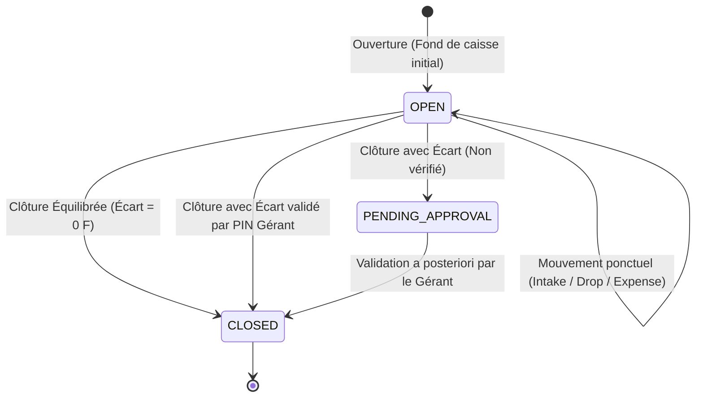

# 06 — Gestion Financière, Sessions de Caisse & Dettes Clients

Ce document détaille les règles métier financières implémentées dans le backend de **ARIKE (VenteApp)** : cycle des sessions de caisse, audit des écarts, gestion des créances et recouvrement des dettes.

---

## 1. Cycle de Vie d'une Session de Caisse

La gestion de caisse dans ARIKE est conçue pour éliminer la démarque inconnue, les vols en caisse et les litiges de fin de journée :

### 1.1 Calcul Mathématique du Solde Théorique Attendu
À tout instant, le solde théorique d'espèces attendu en caisse est calculé selon la formule stricte :

$$\text{Solde Espèces Attendu} = \text{Fond Initial} + \sum \text{Ventes Espèces} + \sum \text{Apports (Intake)} - \sum \text{Versements (Drop)} - \sum \text{Dépenses en Caisse}$$

Pour les paiements dématérialisés (MTN MoMo, Moov Money, Chèque, Virement) :
$$\text{Solde MoMo Attendu} = \sum \text{Ventes MoMo} + \sum \text{Règlements Dettes MoMo}$$

### 1.2 Formule de l'Écart de Caisse
$$\text{Écart de Caisse} = \text{Montant Réel Déclaré} - \text{Montant Théorique Attendu}$$

- Si $\text{Écart} = 0$ : Caisse parfaitement équilibrée. Clôture immédiate autorisée.
- Si $\text{Écart} < 0$ : **Déficit de caisse** (manque d'argent physique). Exige une justification textuelle et l'approbation du gérant via PIN.
- Si $\text{Écart} > 0$ : **Excédent de caisse** (surplus inexpliqué). Exige également une justification et l'approbation du gérant.

---

## 2. Procédure de Clôture & Sécurité Anti-Fraude

1. **Comptage Physique Réel** :
   Le caissier compte ses billets et pièces physiques. Il peut utiliser le bouton d'assistance *"Remplir avec les soldes théoriques attendus"* ou saisir son comptage précis.
2. **Détection d'Écart** :
   Dès qu'un écart est constaté, l'API exige :
   - Un motif d'explication obligatoire (`discrepancy_reason`).
   - La saisie du PIN du propriétaire/gérant (`owner_pin_verification`) OU la mise en attente de validation (`status = PENDING_APPROVAL`).
3. **Session en Attente (`PENDING_APPROVAL`)** :
   Si le gérant n'est pas sur place, la caisse passe en statut temporaire `PENDING_APPROVAL`. Le caissier ne peut plus encaisser de nouvelles ventes sur cette session. Le gérant pourra valider ou rejeter la clôture depuis son back-office ou depuis son smartphone dès son arrivée.

---

## 3. Gestion des Dettes & Recouvrement WhatsApp

Dans le commerce de proximité en Afrique, le crédit client ("Prendre à crédit", "Noter dans le carnet") représente souvent entre 20% et 40% du chiffre d'affaires. ARIKE numérise ce processus pour accélérer les rentrées de trésorerie :

### 3.1 Création d'une Créance
Une dette peut être générée :
- Directement lors d'une vente en sélectionnant le mode de règlement **"Crédit"** ou un paiement partiel (ex : 20 000 F payés en espèces sur un total de 35 000 F $\rightarrow$ création automatique d'une dette de 15 000 F liée à la vente).
- Manuellement pour un compte client existant.

### 3.2 Suivi des Échéances & Alertes
Chaque dette possède une date d'échéance (`due_date`).
- **Statut `ACTIVE`** : Échéance non dépassée.
- **Statut `OVERDUE`** : Échéance dépassée (affichée en rouge dans l'interface, badge d'alerte sur le tableau de bord).

### 3.3 Relance WhatsApp Automatisée
Le backend génère un modèle de relance poli et précis prêt à être envoyé par WhatsApp sans ressaisie :
> *"Bonjour M./Mme [Nom Client], sauf erreur de notre part, votre solde débiteur à la boutique [Nom Boutique] s'élève à [Montant Restant] FCFA (Échéance du [Date]). Merci de bien vouloir régulariser par MTN MoMo au [Numéro MoMo] ou directement en boutique. Cordialement !"*

