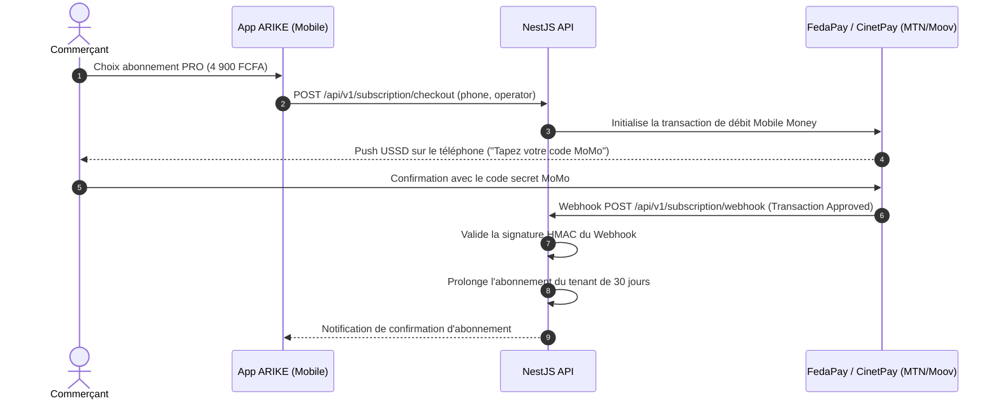

# 07 — Abonnements, Licences & Paiements Mobile Money

Ce document décrit le modèle d'affaires, les formules d'abonnement, le système de licences cryptographiques hors-ligne et les passerelles de paiement intégrées au backend de **ARIKE (VenteApp)**.

---

## 1. Plans d'Abonnement & Quotas

Le backend gère 3 paliers d'abonnement pour les commerçants :

| Fonctionnalité / Quota | Plan GRATUIT (Free) | Plan PRO (Commerçant) | Plan ENTREPRISE (Réseau) |
| :--- | :---: | :---: | :---: |
| **Tarif indicatif** | 0 FCFA / mois | 4 900 FCFA / mois (ou 49 000 F / an) | Sur devis |
| **Nombre de Boutiques** | 1 boutique | Jusqu'à 3 boutiques | Illimité |
| **Nombre d'Utilisateurs** | 1 utilisateur (Owner) | Jusqu'à 5 caissiers/gérants | Illimité |
| **Nombre d'Articles** | 100 articles max | Illimité | Illimité |
| **Fonctionnement Hors-Ligne** | ✅ 100% Hors-Ligne | ✅ 100% Hors-Ligne | ✅ 100% Hors-Ligne |
| **Synchronisation Cloud Multi-Appareils** | ❌ Locale seulement | ✅ Oui (temps réel + backup) | ✅ Oui + Haute disponibilité |
| **Relances WhatsApp Automatisées** | ✅ Inclus | ✅ Inclus | ✅ Inclus + Modèles pro |
| **Gestion des Lots & Péremptions** | ❌ Non | ✅ Oui | ✅ Oui |
| **Support Technique Prioritaire** | Communautaire | WhatsApp dédié 7j/7 | Gestionnaire de compte dédié |

---

## 2. Système de Licences Cryptographiques Hors-Ligne

Puisque de nombreux commerçants opèrent dans des zones blanches sans connexion Internet permanente, ARIKE ne peut pas dépendre d'une vérification d'abonnement en ligne à chaque ouverture d'application :

1. **Génération de Clé de Licence** :
   Le backend dispose d'une paire de clés asymétriques (Clé Privée sur le serveur d'administration / Clé Publique embarquée dans l'application mobile Flutter).
2. **Structure de la Licence** :
   ```json
   {
     "tenant_id": "987fcdeb-51a2-43bb-a123-222222222222",
     "plan": "PRO",
     "shops_limit": 3,
     "users_limit": 5,
     "valid_until": "2027-12-31T23:59:59Z",
     "features": ["cloud_sync", "multi_shop", "lots_tracking"]
   }
   ```
3. **Signature Cryptographique** :
   Le payload est signé avec la clé privée Ed25519 du serveur.
4. **Validation Côté Client** :
   L'application Flutter vérifie l'authenticité de la licence avec la clé publique embarquée. Si la date courante de l'appareil ne dépasse pas `valid_until` et que la signature est intègre, les fonctionnalités PRO restent actives même sans aucune connexion Internet pendant un an.

---

## 3. Passerelles de Paiement Mobile Money & Webhooks

Le backend s'interface avec les principaux agrégateurs de paiement d'Afrique de l'Ouest :



### 3.1 Sécurité des Webhooks
- Chaque requête de webhook est protégée par une signature dans l'en-tête `X-Signature`.
- Le backend recalcule le HMAC-SHA256 avec la clé secrète partagée.
- La transaction est traitée de manière idempotente : si le fournisseur renvoie le même événement plusieurs fois, le compte n'est crédité qu'une seule fois.

