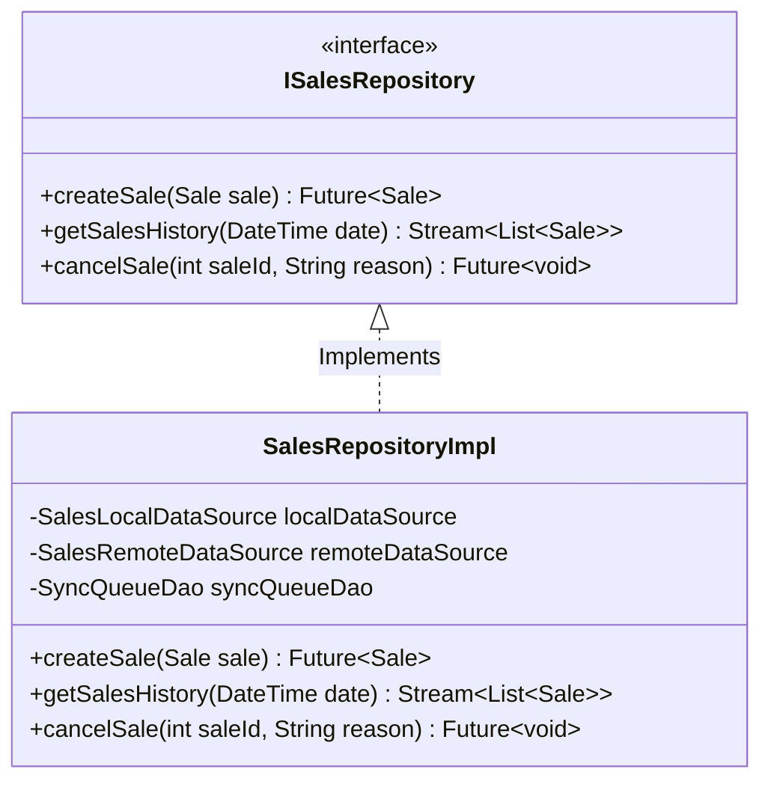

# Guide de Développement & Documentation du Code — VenteApp (ARIKE)

---

## 1. Structure Détaillée des Projets

Le monorepo **VenteApp** est organisé en trois sous-projets étanches et autonomes :
- `frontend/` : Application Mobile Flutter (Android / iOS / Desktop).
- `backend/` : Serveur d'API NestJS (Node.js / TypeScript).
- `back-office/` : Console Web d'Administration Next.js 15 (React 19 / Tailwind).

```
VenteApp/
├── backend/                  # API REST & Sync Engine (NestJS)
│   ├── src/
│   │   ├── core/             # Base de données, sécurité, cache, idempotence
│   │   ├── modules/          # 27+ Modules métier (Auth, Sales, Debts, etc.)
│   │   ├── shared/           # Utilitaires, filtres, intercepteurs, DTOs
│   │   ├── app.module.ts     # Module racine NestJS
│   │   └── main.ts           # Bootstrapping & Swagger
│   ├── supabase/migrations/  # Scripts DDL de migration PostgreSQL
│   └── test/                 # Tests unitaires & E2E (Jest)
│
├── frontend/                 # Application Mobile Offline-First (Flutter)
│   ├── lib/
│   │   ├── app/              # Configuration, thèmes, injection (GetIt)
│   │   ├── core/             # Drift SQLite, Dio, Sync Engine, Chiffrement
│   │   ├── features/         # 28+ Modules UI & Métier (BLoC, Pages, Widgets)
│   │   └── shared/           # Design System ARIKE, Formatters FCFA
│   └── assets/images/        # Logos, icônes et splash screens
│
└── back-office/              # Portail Web de Gestion (Next.js 15)
    ├── src/
    │   ├── app/              # Next.js App Router (Pages, Layouts)
    │   ├── components/       # Composants UI (Tables, Modal, KPIs)
    │   ├── modules/          # Logique d'administration métier
    │   ├── stores/           # Stores Zustand (Auth, Active Shop)
    │   └── types/            # Définitions TypeScript
    └── public/               # Assets statiques
```

---

## 2. Patrons de Conception & Architecture Logicielle

### 2.1 Le Pattern Repository Unifié
Pour découpler la logique métier de la source de données (SQLite locale vs API Cloud), le **Repository Pattern** est strictement appliqué sur Flutter et NestJS :



### 2.2 Gestion des États Mobiles : BLoC (Business Logic Component)
Chaque fonctionnalité possède son triplet immuable :
- `SalesEvent` : Événements déclenchés par l'utilisateur (`ScanBarcodeEvent`, `ApplyDiscountEvent`, `SubmitSaleEvent`).
- `SalesState` : États de la vue (`SalesInitialState`, `CartUpdatedState`, `SaleSubmittingState`, `SaleSuccessState`, `SalesErrorState`).
- `SalesBloc` : Composant transformant les flux d'événements en flux d'états réactifs.

```dart
// Exemple d'implémentation SalesBloc
class SalesBloc extends Bloc<SalesEvent, SalesState> {
  final ISalesRepository salesRepository;

  SalesBloc({required this.salesRepository}) : super(SalesInitialState()) {
    on<SubmitSaleEvent>((event, emit) async {
      emit(SaleSubmittingState());
      try {
        final createdSale = await salesRepository.createSale(event.sale);
        emit(SaleSuccessState(sale: createdSale));
      } catch (e) {
        emit(SalesErrorState(message: e.toString()));
      }
    });
  }
}
```

---

## 3. Guide d'Ajout d'un Nouveau Module (Tutoriel de Bout en Bout)

Supposons l'ajout d'une nouvelle fonctionnalité : **Gestion des Cartes de Fidélité (`loyalty_cards`)**.

### Étape 1 : Modélisation SQLite dans Drift (`frontend/lib/core/database/tables/`)
```dart
import 'package:drift/drift.dart';

class LoyaltyCardsTable extends Table {
  IntColumn get id => integer().autoIncrement()();
  IntColumn get shopId => integer()();
  IntColumn get customerId => integer().references(CustomersTable, #id)();
  TextColumn get cardNumber => text().withLength(min: 8, max: 20).unique()();
  IntColumn get points => integer().withDefault(const Constant(0))();
  IntColumn get createdAt => integer()();
}
```
*Exécuter ensuite la commande de génération :* `dart run build_runner build --delete-conflicting-outputs`.

---

### Étape 2 : Implémentation du BLoC et de l'UI (`frontend/lib/features/loyalty/`)
1. **Entité Métier** : `LoyaltyCard` avec `cardNumber` et `points`.
2. **Repository** : `LoyaltyRepository` exécutant les écritures locales et insérant un événement dans `sync_queue`.
3. **BLoC** : `LoyaltyBloc` émettant les soldes de points en direct.
4. **Interface Utilisateur** : Écran `LoyaltyScanPage` affichant le solde et les remises applicables.

---

### Étape 3 : Création du Module Backend NestJS (`backend/src/modules/loyalty/`)
1. **Script DDL SQL Supabase** : `supabase/migrations/055_loyalty_module.sql`.
2. **DTO de Validation** :
```typescript
import { IsInt, IsNotEmpty, IsString, Min } from 'class-validator';

export class AddLoyaltyPointsDto {
  @IsInt()
  @Min(1)
  customerId: number;

  @IsInt()
  @Min(1)
  pointsToAdd: number;

  @IsString()
  @IsNotEmpty()
  reason: string;
}
```
3. **Contrôleur NestJS** :
```typescript
@Controller('loyalty')
@UseGuards(JwtAuthGuard, TenantGuard, RbacGuard)
export class LoyaltyController {
  constructor(private readonly loyaltyService: LoyaltyService) {}

  @Post('points')
  @RequirePermission('customers.edit')
  async addPoints(@Body() dto: AddLoyaltyPointsDto) {
    return this.loyaltyService.addPoints(dto);
  }
}
```

---

### Étape 4 : Déclaration dans `AppModule` et Intégration Back-Office
- Ajouter `LoyaltyModule` dans `imports` de `backend/src/app.module.ts`.
- Créer la vue d'administration dans `back-office/src/app/loyalty/page.tsx` avec composant TanStack Table.

---

## 4. Injection de Dépendances & Inversion de Contrôle

### 4.1 Injection Mobile (GetIt)
Le fichier `frontend/lib/app/locator.dart` centralise la déclaration des singletons :
```dart
final getIt = GetIt.instance;

void setupServiceLocator() {
  // 1. Core Services & Database
  getIt.registerSingleton<AppDatabase>(AppDatabase());
  getIt.registerLazySingleton<DioClient>(() => DioClient());

  // 2. Repositories
  getIt.registerLazySingleton<ISalesRepository>(
    () => SalesRepositoryImpl(db: getIt<AppDatabase>(), dio: getIt<DioClient>()),
  );

  // 3. BLoCs / Cubits
  getIt.registerFactory<SalesBloc>(
    () => SalesBloc(salesRepository: getIt<ISalesRepository>()),
  );
}
```

### 4.2 Injection Backend (NestJS IoC Container)
Les services sont déclarés avec le décorateur `@Injectable()` et résolus automatiquement par le framework.

---

## 5. Standards de Code, Linting & Bonnes Pratiques

### 5.1 Commandes de Formatage & Validation
- **Mobile (Flutter)** :
  ```bash
  flutter analyze
  dart format lib test
  ```
- **Backend (NestJS)** :
  ```bash
  npm run lint
  npm run format
  ```
- **Back-Office (Next.js)** :
  ```bash
  npm run lint
  ```

### 5.2 Règles de Commits Git (Conventional Commits)
Tous les messages de commit respectent le standard :
- `feat(sales): ajout du support de paiement mixte MoMo/Cash`
- `fix(debts): correction du calcul de solde lors d'un pardon partiel`
- `docs(api): mise à jour de la documentation Swagger pour le module FX`
- `refactor(sync): optimisation de l'isolate de fond pour la file FIFO`
- `test(e2e): ajout du scénario de clôture de caisse avec écart`
