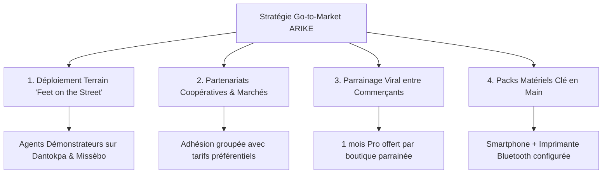
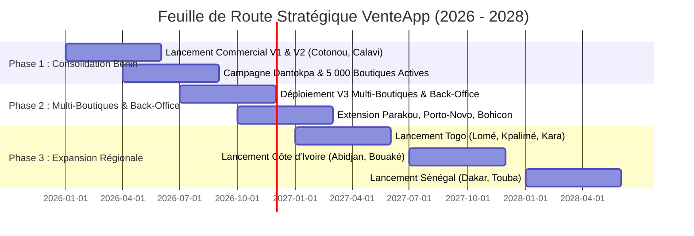

# Stratégie Produit, Go-to-Market & Modèle Économique — VenteApp (ARIKE)

---

## 1. Analyse Stratégique du Marché & Écosystème Cible

### 1.1 Le Marché du Commerce en Afrique de l'Ouest
En Afrique de l'Ouest (Bénin, Togo, Côte d'Ivoire, Sénégal, Burkina Faso, Niger), le secteur du commerce de détail et de demi-gros représente plus de **60% du PIB non agricole** et emploie plus de **80% de la population active urbaine**.

```
┌────────────────────────────────────────────────────────────────────────┐
│                   CARTOGRAPHIE DES CIBLES PRIORITAIRES                 │
├─────────────────────┬──────────────────────┬───────────────────────────┤
│ Segment Commercial  │ Typologie de Commerce│ Volume Estimé (Bénin)     │
├─────────────────────┼──────────────────────┼───────────────────────────┤
│ **Micro-Détaillants**│ Boutiques de quartier│ > 150 000 points de vente │
│                     │ Kiosques, Épiceries  │                           │
├─────────────────────┼──────────────────────┼───────────────────────────┤
│ **Boutiques &       │ Supérettes, Cosmétique│ > 35 000 points de vente  │
│ Commerces Moyens**  │ Quincailleries, Prêt │                           │
├─────────────────────┼──────────────────────┼───────────────────────────┤
│ **Demi-Grossistes & │ Marchés Dantokpa,    │ > 12 000 établissements   │
│ Distributeurs**     │ Ganhi, Ouando, Parakou│                           │
└─────────────────────┴──────────────────────┴───────────────────────────┘
```

---

## 2. Proposition de Valeur Unique (UVP) & Avantages Compétitifs

| Dimension | Solutions Concurrentes Classiques | **VenteApp (ARIKE)** |
| :--- | :--- | :--- |
| **Dépendance Réseau** | Cloud obligatoire (bloqué si pas de 4G) | **100% Offline-First** (fonctionne sans Internet) |
| **Gestion des Dettes** | Inexistante ou formulaire rigide | **Module Dettes Culturel** (Acomptes, Pardon, WhatsApp) |
| **Vitesse d'Encaissement**| Lente (> 20 secondes par client) | **Ultra-Rapide (< 3 secondes en Vente Flash)** |
| **Matériel Requis** | Caisses tactiles propriétaires ($800+) | **Smartphone Android classique de l'utilisateur** |
| **Monnaie & Tarifs** | Devises étrangères ou centimes | **100% FCFA strict sans centimes inutiles** |
| **Traçabilité Interne** | Risque élevé de fraude et coulage | **Audit Trail Inviolable** (Qui, Quand, Pourquoi) |

---

## 3. Stratégie Go-to-Market (GTM) & Canaux d'Acquisition



### 3.1 Déploiement Terrain ("Feet on the Street")
- Déploiement d'une équipe de **démonstrateurs de marché** équipés de smartphones et imprimantes thermiques de démonstration.
- **Onboarding express en 15 minutes** : installation directe, saisie des 10 premiers produits du commerçant et impression de son premier ticket personnalisé.

### 3.2 Partenariats Stratégiques
- Accords avec les associations de commerçants des grands marchés (Dantokpa, Ganhi, Ouando).
- Partenariats avec les distributeurs de boissons, grossistes de denrées et opérateurs de Mobile Money (MTN, Moov).

---

## 4. Modèle Économique & Grille Tarifaire SaaS

Le modèle économique repose sur une formule **Freemium SaaS** par abonnement récurrent, complétée par la vente de matériel et de services à valeur ajoutée. 

### 4.1 Offre Automatique à l'Installation (Zero Friction Onboarding)
Dès le premier lancement de l'application sur son smartphone, le commerçant bénéficie **automatiquement et sans aucune carte bancaire ni démarche administrative** du forfait **GRATUIT (Starter)** :

```
┌────────────────────────────────────────────────────────────────────────┐
│             OFFRE AUTOMATIQUE À L'INSTALLATION DE L'APP                │
├─────────────────────┬──────────────────────┬───────────────────────────┤
│ Forfait             │ Tarification         │ Fonctionnalités Incluses  │
├─────────────────────┼──────────────────────┼───────────────────────────┤
│ **GRATUIT**         │ **0 FCFA**           │ • 1 Boutique, 1 Utilisateur│
│ *(Starter)*         │ À vie                │ • 100% Offline Local      │
│                     │                      │ • Ventes, Stock, Dettes   │
└─────────────────────┴──────────────────────┴───────────────────────────┘
```

> **Principe d'Accessibilité Universelle :**
> L'artisan commerçant peut utiliser VenteApp **gratuitement et indéfiniment** pour ses besoins essentiels sans être forcé de souscrire un abonnement payant. L'évolution vers les forfaits Pro ou Entreprise est un choix volontaire lorsqu'il grandit (embauche de vendeurs, ouverture d'autres boutiques, besoin de synchronisation cloud).

```
┌────────────────────────────────────────────────────────────────────────┐
│                      GRILLE TARIFAIRE VENTEAPP                         │
├─────────────────────┬──────────────────────┬───────────────────────────┤
│ Forfait             │ Tarification         │ Fonctionnalités Incluses  │
├─────────────────────┼──────────────────────┼───────────────────────────┤
│ **GRATUIT**         │ **0 FCFA**           │ • 1 Boutique, 1 Utilisateur│
│ *(Starter)*         │ À vie                │ • 100% Offline Local      │
│ *(Par Défaut)*      │                      │ • Ventes, Stock, Dettes   │
│                     │                      │ • Reçus WhatsApp & Tickets│
│                     │                      │ • Notifications sonores   │
├─────────────────────┼──────────────────────┼───────────────────────────┤
│ **PRO**             │ **5 000 FCFA / mois**│ • Multi-utilisateurs      │
│ *(Commerçant)*      │ *(ou 50 000 F / an)* │ • Synchronisation Cloud   │
│                     │                      │ • Sauvegarde Google Drive │
│                     │                      │ • Sessions & Dépenses     │
│                     │                      │ • Relances WhatsApp       │
├─────────────────────┼──────────────────────┼───────────────────────────┤
│ **ENTREPRISE**      │ **15 000 FCFA / mois**│ • Multi-Boutiques illimité│
│ *(Réseau & Gros)*   │ *(ou 150 000 F / an)*│ • Back-Office Web Central │
│                     │                      │ • Transferts inter-stocks │
│                     │                      │ • Module Bureau de Change │
│                     │                      │ • Support VIP Dédié       │
└─────────────────────┴──────────────────────┴───────────────────────────┘
```

### 4.2 Packs Matériels Clé en Main
- **Pack "Caisse Starter" (45 000 FCFA)** : Imprimante thermique Bluetooth 58mm + 10 rouleaux de papier thermique + 3 mois d'abonnement Pro offerts.
- **Pack "Commerce Pro" (110 000 FCFA)** : Smartphone Android 4G configuré + Imprimante thermique Bluetooth + Support de caisse + 6 mois d'abonnement Pro.

### 4.3 Système de Notifications Proactives Hors-Application (Avec Alerte Sonore)
Pour assurer un suivi commercial rigoureux sans exiger que le commerçant garde l'application ouverte en permanence :
- **Déclenchement Autonome en Arrière-Plan** : Les notifications (stock critique, créances en retard, clôture de 20h00) sont programmées via le système d'alarme de l'OS et s'affichent **même si l'application est totalement fermée**.
- **Alerte Sonore & Vibrations Audibles** : Les notifications sont diffusées avec le signal sonore du téléphone (canal haute importance) pour capter l'attention du commerçant dans l'ambiance animée du marché.

---

## 5. Feuille de Route Stratégique 2026 – 2028 (Roadmap)



---

## 6. Projections Financières & Indicateurs de Croissance

| Indicateur Clé | Fin 2026 | Fin 2027 | Fin 2028 |
| :--- | :---: | :---: | :---: |
| **Boutiques Actives Totales** | 7 500 | 25 000 | 75 000 |
| **Comptes Abonnés Payants (Pro/Entreprise)** | 2 200 (30%) | 9 500 (38%) | 32 000 (43%) |
| **Revenu Récurrent Mensuel (MRR)** | 14 000 000 FCFA | 65 000 000 FCFA | 230 000 000 FCFA |
| **Volume de Transactions Tracées / mois** | 1,5 Milliard F | 8 Milliards F | 35 Milliards F |
