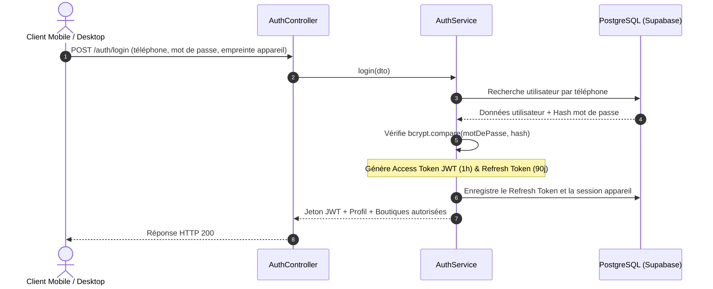
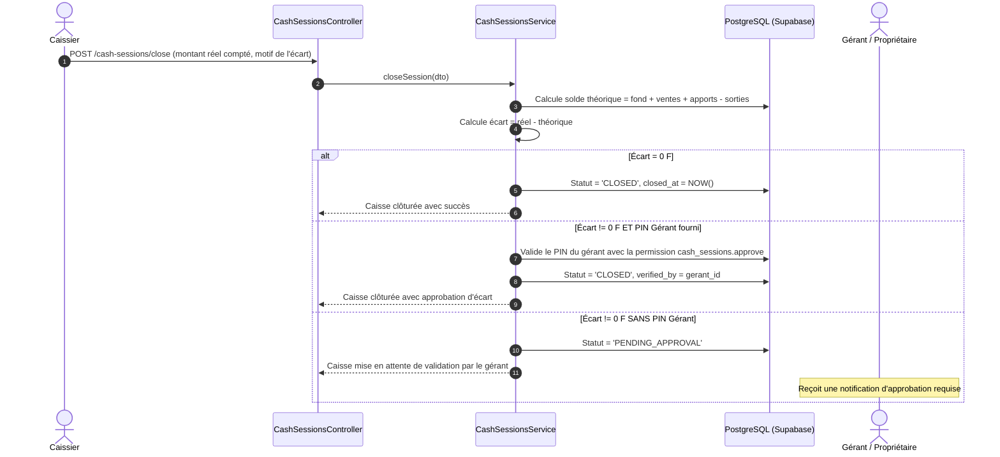

# Flux de Données Critiques du Backend

Ce document documente les flux d'informations de bout en bout pour les scénarios les plus sensibles du système.

---

## 1. Flux d'Authentification & Émission de Jetons

---

## 2. Flux de Clôture de Caisse avec Écart

