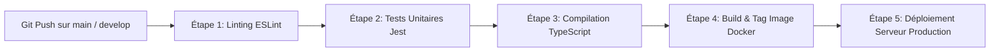

# Pipeline d'Intégration & Déploiement Continu (CI/CD)

Ce document décrit le pipeline automatisé d'intégration et de livraison continue pour le backend ARIKE.

---

## 1. Déroulement du Pipeline CI/CD



---

## 2. Exemple de Workflow GitHub Actions (`.github/workflows/backend-ci.yml`)

```yaml
name: Backend CI/CD Pipeline

on:
  push:
    branches: [ main, develop ]
    paths:
      - 'backend/**'

jobs:
  build-and-test:
    runs-on: ubuntu-latest
    defaults:
      run:
        working-directory: ./backend

    steps:
    - uses: actions/checkout@v4

    - name: Setup Node.js 20
      uses: actions/setup-node@v4
      with:
        node-version: '20'
        cache: 'npm'
        cache-dependency-path: backend/package-lock.json

    - name: Installer les dépendances
      run: npm ci

    - name: Vérification du code (Linter)
      run: npm run lint

    - name: Exécution des tests unitaires
      run: npm run test

    - name: Compilation de production (NestJS Build)
      run: npm run build
```

